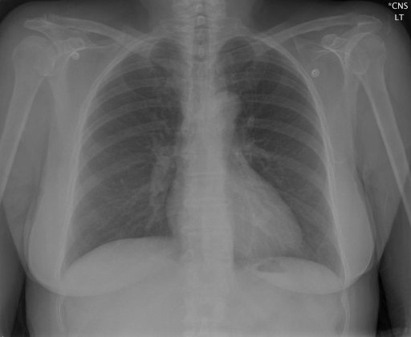

# chexbench_rad_restruct_0126
Ordinal 4; source Rad-Restruct; stopped-prefix record.

Are there any diseases in the trachea?

## Complete options

- **A**: yes
- **B**: no

## Original images

Explicit answer: **B. no**; reference: **B**; correct: **True**.

Both MedGemma and ChestXrayExpert confirm the trachea is midline with normal caliber and no visible abnormalities.

[Prediction](../../evidence/chexbench/predictions/M43-IM-GT-S50-CXR6/chexbench_rad_restruct_0126.json) · [own post-prediction feedback](../../evidence/chexbench/feedback/chexbench_rad_restruct_0126.json) · [exact context and Skill version](../../evidence/chexbench/contexts/chexbench_rad_restruct_0126.json) · [all main requests/responses](../../evidence/chexbench/services/calls/R50-AGENT/chexbench_rad_restruct_0126)

## Tool requests and observations

- medgemma: status=completed; [selection](../../evidence/chexbench/services/tool_selections/R50-AGENT/chexbench_rad_restruct_0126/1.json), [full request/result/stdout/stderr artifacts](../../evidence/chexbench/services/tool_cache/1e45d6ae5aac6651c8074c80543962adaacfa71341822b0d88cc00026e32afc0).
- chest_xray_expert: status=completed; [selection](../../evidence/chexbench/services/tool_selections/R50-AGENT/chexbench_rad_restruct_0126/2.json), [full request/result/stdout/stderr artifacts](../../evidence/chexbench/services/tool_cache/1c0147bf74bee04a7b160a056af403e9d5fb17dec478c88e7205b1815dc7c6eb).

## Skill and prior-image provenance

Selected IDs: []; prior same-image IDs: [].

This is dataset-label scoring and model/tool narrative, not clinical adjudication or Skill causal verification.
