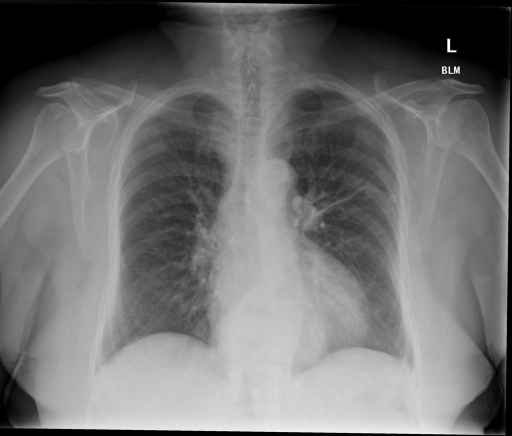
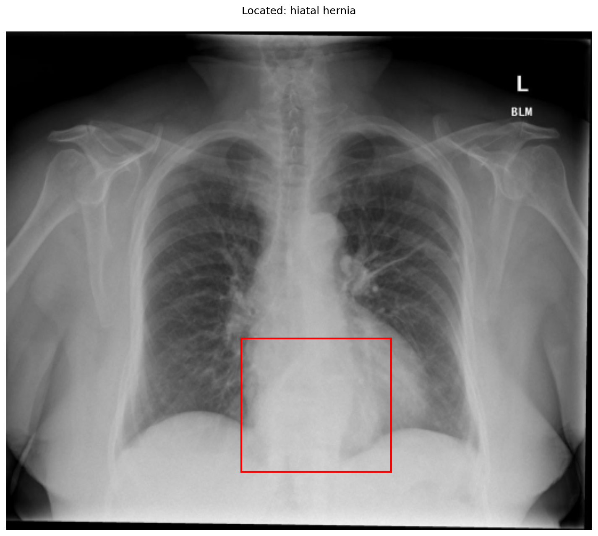

# chexbench_rad_restruct_0127
Ordinal 5; source Rad-Restruct; stopped-prefix record.

Are there any diseases in the thorax?

## Complete options

- **A**: no
- **B**: yes

## Original images

Explicit answer: **B. yes**; reference: **A**; correct: **False**.

Grounding evidence confirms a hiatal hernia in the thorax, indicating the presence of disease.

[Prediction](../../evidence/chexbench/predictions/M43-IM-GT-S50-CXR6/chexbench_rad_restruct_0127.json) · [own post-prediction feedback](../../evidence/chexbench/feedback/chexbench_rad_restruct_0127.json) · [exact context and Skill version](../../evidence/chexbench/contexts/chexbench_rad_restruct_0127.json) · [all main requests/responses](../../evidence/chexbench/services/calls/R50-AGENT/chexbench_rad_restruct_0127)

## Tool requests and observations

- medgemma: status=completed; [selection](../../evidence/chexbench/services/tool_selections/R50-AGENT/chexbench_rad_restruct_0127/1.json), [full request/result/stdout/stderr artifacts](../../evidence/chexbench/services/tool_cache/b404f5ffb85c4691a8cd407884842bc99033531df12db27c36b645b6a26fee40).
- chest_xray_expert: status=completed; [selection](../../evidence/chexbench/services/tool_selections/R50-AGENT/chexbench_rad_restruct_0127/2.json), [full request/result/stdout/stderr artifacts](../../evidence/chexbench/services/tool_cache/bc4f884b887af87fd38cefc8dc83a7b9861437683358cb037da80b1968a94f74).
- llava_rad: status=completed; [selection](../../evidence/chexbench/services/tool_selections/R50-AGENT/chexbench_rad_restruct_0127/3.json), [full request/result/stdout/stderr artifacts](../../evidence/chexbench/services/tool_cache/9c0b37907ee5800f5addd18fab068d2440a8b5c421cacb12424537ba32c4322d).
- medvlm_r1: status=completed; [selection](../../evidence/chexbench/services/tool_selections/R50-AGENT/chexbench_rad_restruct_0127/4.json), [full request/result/stdout/stderr artifacts](../../evidence/chexbench/services/tool_cache/0031d78457118145052719f0b07b18774732604ee58bee1593d8bc6393be6c36).
- xray_phrase_grounding: status=completed; [selection](../../evidence/chexbench/services/tool_selections/R50-AGENT/chexbench_rad_restruct_0127/5.json), [full request/result/stdout/stderr artifacts](../../evidence/chexbench/services/tool_cache/4d69578a577862ce1cd3eac6b1e655dcb9924e601faf46266d4b44d58ccc817d).

## Skill and prior-image provenance

Selected IDs: []; prior same-image IDs: [].

This is dataset-label scoring and model/tool narrative, not clinical adjudication or Skill causal verification.
