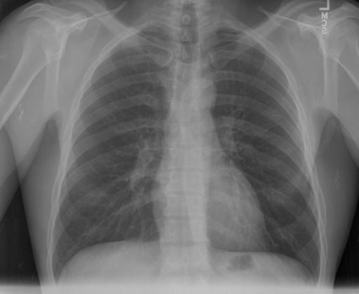

# chexbench_rad_restruct_0128
Ordinal 6; source Rad-Restruct; stopped-prefix record.

Are there any signs in the cardiovascular system?

## Complete options

- **A**: no
- **B**: yes

## Original images

Explicit answer: **A. no**; reference: **A**; correct: **True**.

Two models (medgemma and llava_rad) report no cardiovascular abnormalities, while the single affirmative response from chest_xray_expert is ambiguous and likely refers to normalcy rather than pathology.

[Prediction](../../evidence/chexbench/predictions/M43-IM-GT-S50-CXR6/chexbench_rad_restruct_0128.json) · [own post-prediction feedback](../../evidence/chexbench/feedback/chexbench_rad_restruct_0128.json) · [exact context and Skill version](../../evidence/chexbench/contexts/chexbench_rad_restruct_0128.json) · [all main requests/responses](../../evidence/chexbench/services/calls/R50-AGENT/chexbench_rad_restruct_0128)

## Tool requests and observations

- medgemma: status=completed; [selection](../../evidence/chexbench/services/tool_selections/R50-AGENT/chexbench_rad_restruct_0128/1.json), [full request/result/stdout/stderr artifacts](../../evidence/chexbench/services/tool_cache/97ee9ac1e0ffac30598117d39259cedbf3cc32dcb027bc8d61ed9cb1f8ca6357).
- chest_xray_expert: status=completed; [selection](../../evidence/chexbench/services/tool_selections/R50-AGENT/chexbench_rad_restruct_0128/2.json), [full request/result/stdout/stderr artifacts](../../evidence/chexbench/services/tool_cache/60271dcdc7e07f9268ceff7f2c4dc9c3ea3fdcc9b86a050b5153bd48d7ca8af2).
- llava_rad: status=completed; [selection](../../evidence/chexbench/services/tool_selections/R50-AGENT/chexbench_rad_restruct_0128/3.json), [full request/result/stdout/stderr artifacts](../../evidence/chexbench/services/tool_cache/75eaac712f3e89691df01f0d60d08eca1356084eab4b13a5b66097f64c7c78ea).

## Skill and prior-image provenance

Selected IDs: []; prior same-image IDs: [].

This is dataset-label scoring and model/tool narrative, not clinical adjudication or Skill causal verification.
