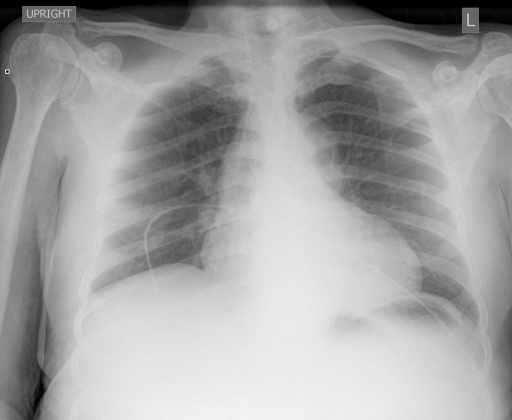

# chexbench_rad_restruct_0129
Ordinal 7; source Rad-Restruct; stopped-prefix record.

Are there any signs in the pleura?

## Complete options

- **A**: yes
- **B**: no

## Original images

Explicit answer: **B. no**; reference: **B**; correct: **True**.

Both MedGemma and CheXagent report no visible pleural abnormalities such as effusion, thickening, or pneumothorax in the chest X-ray.

[Prediction](../../evidence/chexbench/predictions/M43-IM-GT-S50-CXR6/chexbench_rad_restruct_0129.json) · [own post-prediction feedback](../../evidence/chexbench/feedback/chexbench_rad_restruct_0129.json) · [exact context and Skill version](../../evidence/chexbench/contexts/chexbench_rad_restruct_0129.json) · [all main requests/responses](../../evidence/chexbench/services/calls/R50-AGENT/chexbench_rad_restruct_0129)

## Tool requests and observations

- medgemma: status=completed; [selection](../../evidence/chexbench/services/tool_selections/R50-AGENT/chexbench_rad_restruct_0129/1.json), [full request/result/stdout/stderr artifacts](../../evidence/chexbench/services/tool_cache/f50b134b8737cde6e7c88f6148a3b67de7c82dc586f9b6cf031e5d61c07c30ae).
- chest_xray_expert: status=completed; [selection](../../evidence/chexbench/services/tool_selections/R50-AGENT/chexbench_rad_restruct_0129/2.json), [full request/result/stdout/stderr artifacts](../../evidence/chexbench/services/tool_cache/84cd78994a23163eb8d765819427f6be23e9d94fb1821aacefe7b0fcf25fe53a).

## Skill and prior-image provenance

Selected IDs: []; prior same-image IDs: [].

This is dataset-label scoring and model/tool narrative, not clinical adjudication or Skill causal verification.
