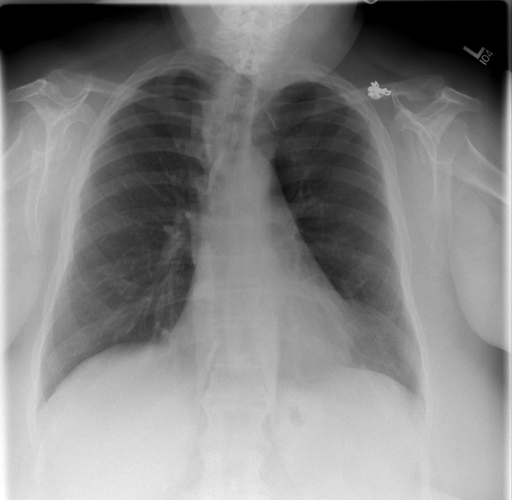

# chexbench_rad_restruct_0130
Ordinal 8; source Rad-Restruct; stopped-prefix record.

Are there any diseases in the thorax?

## Complete options

- **A**: yes
- **B**: no

## Original images

Explicit answer: **B. no**; reference: **B**; correct: **True**.

Both MedGemma and CheXagent models independently assessed the chest X-ray as normal with no signs of disease.

[Prediction](../../evidence/chexbench/predictions/M43-IM-GT-S50-CXR6/chexbench_rad_restruct_0130.json) · [own post-prediction feedback](../../evidence/chexbench/feedback/chexbench_rad_restruct_0130.json) · [exact context and Skill version](../../evidence/chexbench/contexts/chexbench_rad_restruct_0130.json) · [all main requests/responses](../../evidence/chexbench/services/calls/R50-AGENT/chexbench_rad_restruct_0130)

## Tool requests and observations

- medgemma: status=completed; [selection](../../evidence/chexbench/services/tool_selections/R50-AGENT/chexbench_rad_restruct_0130/1.json), [full request/result/stdout/stderr artifacts](../../evidence/chexbench/services/tool_cache/7fa02e581681083a08291071fa688965e1f1d115b0ae947356b4a38dbaec0933).
- chest_xray_expert: status=completed; [selection](../../evidence/chexbench/services/tool_selections/R50-AGENT/chexbench_rad_restruct_0130/2.json), [full request/result/stdout/stderr artifacts](../../evidence/chexbench/services/tool_cache/1c4ecb7960b5b111813aecda7b880730a43348c7f50b10c6d7ef3920c290b7d1).

## Skill and prior-image provenance

Selected IDs: []; prior same-image IDs: [].

This is dataset-label scoring and model/tool narrative, not clinical adjudication or Skill causal verification.
