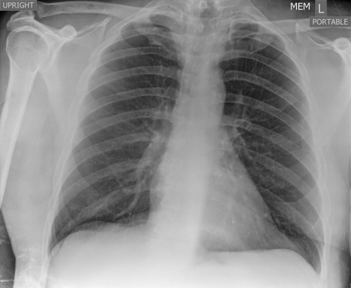

# chexbench_rad_restruct_0131
Ordinal 9; source Rad-Restruct; stopped-prefix record.

Is there anything abnormal in the pleura?

## Complete options

- **A**: yes
- **B**: no

## Original images

Explicit answer: **B. no**; reference: **B**; correct: **True**.

Both chest_xray_expert and medgemma confirm no evidence of pleural effusion, pneumothorax, or thickening.

[Prediction](../../evidence/chexbench/predictions/M43-IM-GT-S50-CXR6/chexbench_rad_restruct_0131.json) · [own post-prediction feedback](../../evidence/chexbench/feedback/chexbench_rad_restruct_0131.json) · [exact context and Skill version](../../evidence/chexbench/contexts/chexbench_rad_restruct_0131.json) · [all main requests/responses](../../evidence/chexbench/services/calls/R50-AGENT/chexbench_rad_restruct_0131)

## Tool requests and observations

- chest_xray_expert: status=completed; [selection](../../evidence/chexbench/services/tool_selections/R50-AGENT/chexbench_rad_restruct_0131/1.json), [full request/result/stdout/stderr artifacts](../../evidence/chexbench/services/tool_cache/0a932833cf755343c32ee537fe35faba735314f92a79315d03d8eec329382c1e).
- medgemma: status=completed; [selection](../../evidence/chexbench/services/tool_selections/R50-AGENT/chexbench_rad_restruct_0131/2.json), [full request/result/stdout/stderr artifacts](../../evidence/chexbench/services/tool_cache/4cdd24f9909536b23ee0dbde85dd0c26702289681c7caa9dfdd38a6a19304c0a).

## Skill and prior-image provenance

Selected IDs: []; prior same-image IDs: [].

This is dataset-label scoring and model/tool narrative, not clinical adjudication or Skill causal verification.
