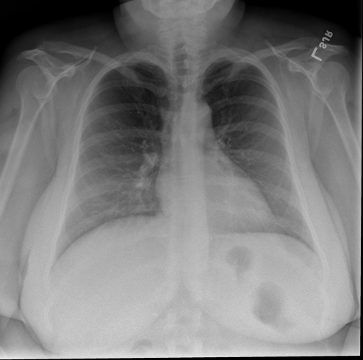

# chexbench_rad_restruct_0132
Ordinal 10; source Rad-Restruct; stopped-prefix record.

Is there anything abnormal in the abdomen?

## Complete options

- **A**: no
- **B**: yes

## Original images

Explicit answer: **A. no**; reference: **A**; correct: **True**.

The visible upper abdomen shows a normal gastric bubble and no evidence of free air, organomegaly, or abnormal calcifications.

[Prediction](../../evidence/chexbench/predictions/M43-IM-GT-S50-CXR6/chexbench_rad_restruct_0132.json) · [own post-prediction feedback](../../evidence/chexbench/feedback/chexbench_rad_restruct_0132.json) · [exact context and Skill version](../../evidence/chexbench/contexts/chexbench_rad_restruct_0132.json) · [all main requests/responses](../../evidence/chexbench/services/calls/R50-AGENT/chexbench_rad_restruct_0132)

## Tool requests and observations

- medgemma: status=completed; [selection](../../evidence/chexbench/services/tool_selections/R50-AGENT/chexbench_rad_restruct_0132/1.json), [full request/result/stdout/stderr artifacts](../../evidence/chexbench/services/tool_cache/d3f83e62233a1d054c5c4fb896c739b89faaa29035d55f362f571373b459ee77).
- chest_xray_expert: status=completed; [selection](../../evidence/chexbench/services/tool_selections/R50-AGENT/chexbench_rad_restruct_0132/2.json), [full request/result/stdout/stderr artifacts](../../evidence/chexbench/services/tool_cache/6406612d483cd1b79da68fee8ff66b6251c91507341a6036d1b97b2a3903cbe4).

## Skill and prior-image provenance

Selected IDs: []; prior same-image IDs: [].

This is dataset-label scoring and model/tool narrative, not clinical adjudication or Skill causal verification.
