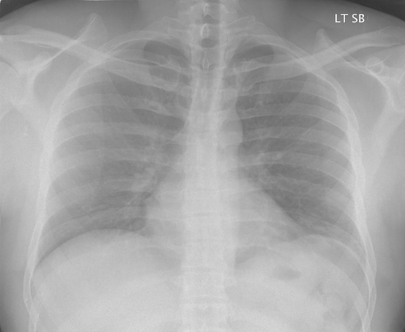

# chexbench_rad_restruct_0133
Ordinal 11; source Rad-Restruct; stopped-prefix record.

Is there anything abnormal in the pleura?

## Complete options

- **A**: yes
- **B**: no

## Original images

Explicit answer: **B. no**; reference: **B**; correct: **True**.

Both expert models confirm sharp costophrenic angles and no evidence of pleural effusion, pneumothorax, or thickening.

[Prediction](../../evidence/chexbench/predictions/M43-IM-GT-S50-CXR6/chexbench_rad_restruct_0133.json) · [own post-prediction feedback](../../evidence/chexbench/feedback/chexbench_rad_restruct_0133.json) · [exact context and Skill version](../../evidence/chexbench/contexts/chexbench_rad_restruct_0133.json) · [all main requests/responses](../../evidence/chexbench/services/calls/R50-AGENT/chexbench_rad_restruct_0133)

## Tool requests and observations

- medgemma: status=completed; [selection](../../evidence/chexbench/services/tool_selections/R50-AGENT/chexbench_rad_restruct_0133/1.json), [full request/result/stdout/stderr artifacts](../../evidence/chexbench/services/tool_cache/455472fb7bee951d29dc03233a1428f6322ca2ae6e929fea47ff890d55406788).
- chest_xray_expert: status=completed; [selection](../../evidence/chexbench/services/tool_selections/R50-AGENT/chexbench_rad_restruct_0133/2.json), [full request/result/stdout/stderr artifacts](../../evidence/chexbench/services/tool_cache/14509ba2cef35eaf0bd5813969ad767e381f01f009b3e4ed1728b084829c2865).

## Skill and prior-image provenance

Selected IDs: []; prior same-image IDs: [].

This is dataset-label scoring and model/tool narrative, not clinical adjudication or Skill causal verification.
