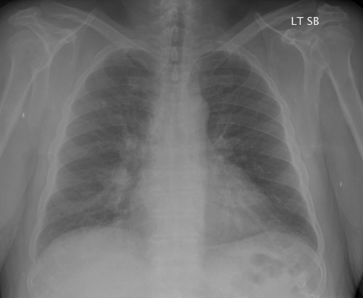
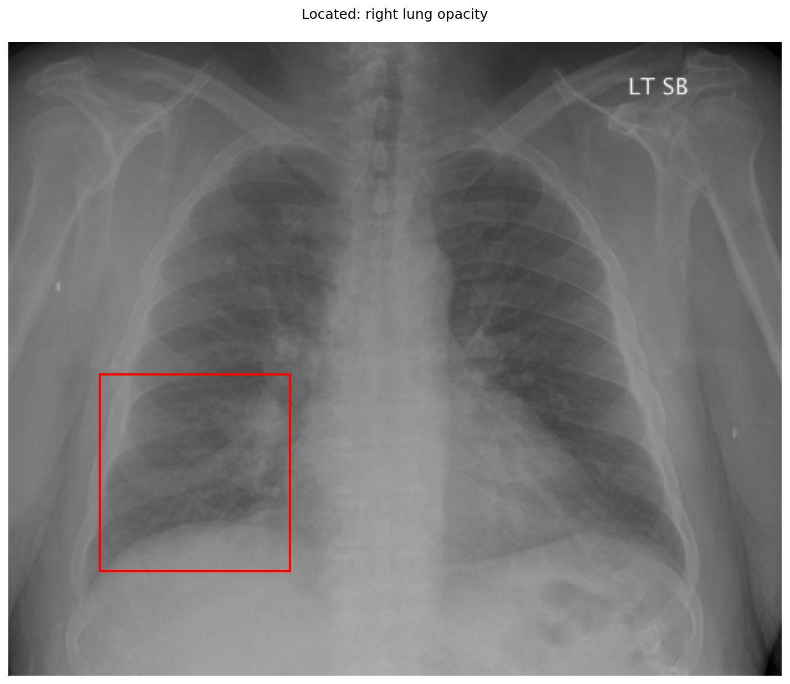

# chexbench_rad_restruct_0134
Ordinal 12; source Rad-Restruct; stopped-prefix record.

Is there anything abnormal in the lung?

## Complete options

- **A**: no
- **B**: yes

## Original images

Explicit answer: **B. yes**; reference: **A**; correct: **False**.

Grounding visualization and llava_rad confirm a right lung opacity/mass, indicating abnormality despite one model reporting normal lungs.

[Prediction](../../evidence/chexbench/predictions/M43-IM-GT-S50-CXR6/chexbench_rad_restruct_0134.json) · [own post-prediction feedback](../../evidence/chexbench/feedback/chexbench_rad_restruct_0134.json) · [exact context and Skill version](../../evidence/chexbench/contexts/chexbench_rad_restruct_0134.json) · [all main requests/responses](../../evidence/chexbench/services/calls/R50-AGENT/chexbench_rad_restruct_0134)

## Tool requests and observations

- medgemma: status=completed; [selection](../../evidence/chexbench/services/tool_selections/R50-AGENT/chexbench_rad_restruct_0134/1.json), [full request/result/stdout/stderr artifacts](../../evidence/chexbench/services/tool_cache/dd571d3bf746d105078b2f7fcc8a95ab578975df1fc1788d5cf0d6bf2f7c6d68).
- chest_xray_expert: status=completed; [selection](../../evidence/chexbench/services/tool_selections/R50-AGENT/chexbench_rad_restruct_0134/2.json), [full request/result/stdout/stderr artifacts](../../evidence/chexbench/services/tool_cache/9ec01b4f25ae3672650fccc47c18a012af4f3ec0df7c66205feba274d3b030be).
- xray_phrase_grounding: status=completed; [selection](../../evidence/chexbench/services/tool_selections/R50-AGENT/chexbench_rad_restruct_0134/3.json), [full request/result/stdout/stderr artifacts](../../evidence/chexbench/services/tool_cache/01680f9afb83e2282d52c6b7d19b272caebbe57aa3928b59fa91d66fa0de138a).

- llava_rad: status=completed; [selection](../../evidence/chexbench/services/tool_selections/R50-AGENT/chexbench_rad_restruct_0134/4.json), [full request/result/stdout/stderr artifacts](../../evidence/chexbench/services/tool_cache/f88ee5b866c2b776122a2c3f99ba94691b9b03436fe994c0dd75e17568f704ed).

## Skill and prior-image provenance

Selected IDs: []; prior same-image IDs: [].

This is dataset-label scoring and model/tool narrative, not clinical adjudication or Skill causal verification.
