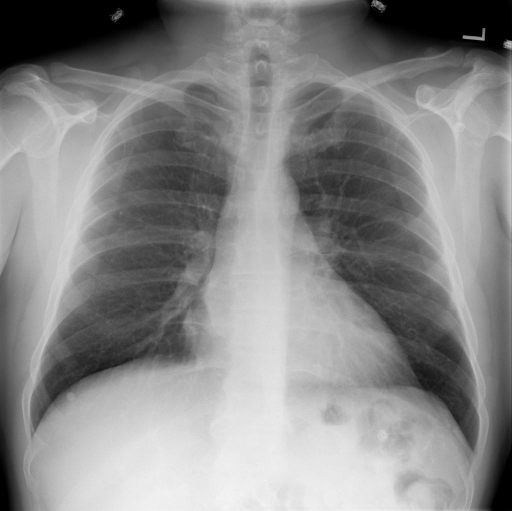

# chexbench_rad_restruct_0135
Ordinal 13; source Rad-Restruct; stopped-prefix record.

Is there anything abnormal in the pleura?

## Complete options

- **A**: no
- **B**: yes

## Original images

Explicit answer: **A. no**; reference: **A**; correct: **True**.

Both MedGemma and CheXagent confirm sharp costophrenic angles and no evidence of pleural effusion, pneumothorax, or thickening.

[Prediction](../../evidence/chexbench/predictions/M43-IM-GT-S50-CXR6/chexbench_rad_restruct_0135.json) · [own post-prediction feedback](../../evidence/chexbench/feedback/chexbench_rad_restruct_0135.json) · [exact context and Skill version](../../evidence/chexbench/contexts/chexbench_rad_restruct_0135.json) · [all main requests/responses](../../evidence/chexbench/services/calls/R50-AGENT/chexbench_rad_restruct_0135)

## Tool requests and observations

- medgemma: status=completed; [selection](../../evidence/chexbench/services/tool_selections/R50-AGENT/chexbench_rad_restruct_0135/1.json), [full request/result/stdout/stderr artifacts](../../evidence/chexbench/services/tool_cache/c3ee614fc5733e8e218d1f9afedbf97f5c069ae3ee823c90bd868e02b482b795).
- chest_xray_expert: status=completed; [selection](../../evidence/chexbench/services/tool_selections/R50-AGENT/chexbench_rad_restruct_0135/2.json), [full request/result/stdout/stderr artifacts](../../evidence/chexbench/services/tool_cache/4f499eea6cf8823d2c880eba2f9f72d56171f57a23269b7471ffd63502cddaa1).

## Skill and prior-image provenance

Selected IDs: []; prior same-image IDs: [].

This is dataset-label scoring and model/tool narrative, not clinical adjudication or Skill causal verification.
