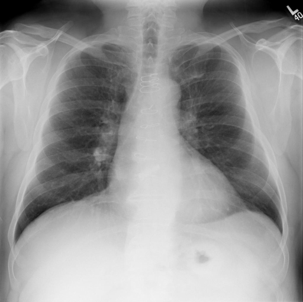
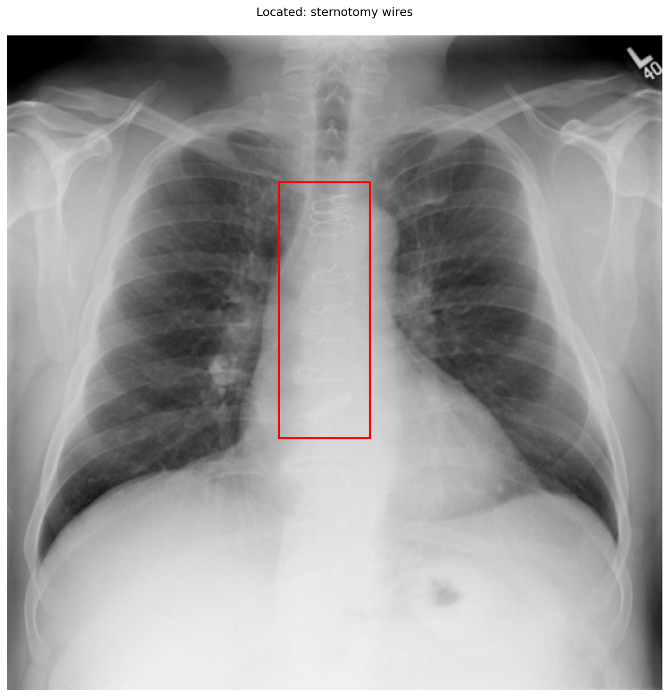

# chexbench_rad_restruct_0137
Ordinal 15; source Rad-Restruct; stopped-prefix record.

Are there any signs in the cardiovascular system?

## Complete options

- **A**: yes
- **B**: no

## Original images

Explicit answer: **A. yes**; reference: **B**; correct: **False**.

Sternotomy wires are visible in the mediastinum, indicating prior cardiac surgery and thus a sign related to the cardiovascular system.

[Prediction](../../evidence/chexbench/predictions/M43-IM-GT-S50-CXR6/chexbench_rad_restruct_0137.json) · [own post-prediction feedback](../../evidence/chexbench/feedback/chexbench_rad_restruct_0137.json) · [exact context and Skill version](../../evidence/chexbench/contexts/chexbench_rad_restruct_0137.json) · [all main requests/responses](../../evidence/chexbench/services/calls/R50-AGENT/chexbench_rad_restruct_0137)

## Tool requests and observations

- xray_phrase_grounding: status=completed; [selection](../../evidence/chexbench/services/tool_selections/R50-AGENT/chexbench_rad_restruct_0137/1.json), [full request/result/stdout/stderr artifacts](../../evidence/chexbench/services/tool_cache/1c10485bc4ac66aa25576a6bb9ff8ff17c800e69de5efca030740cab9485bad3).

- medgemma: status=completed; [selection](../../evidence/chexbench/services/tool_selections/R50-AGENT/chexbench_rad_restruct_0137/2.json), [full request/result/stdout/stderr artifacts](../../evidence/chexbench/services/tool_cache/acdf6cf1b4576e054a870a1cb1a36cb83fc8f1e2d08594d419318a46f3912247).

## Skill and prior-image provenance

Selected IDs: []; prior same-image IDs: [].

This is dataset-label scoring and model/tool narrative, not clinical adjudication or Skill causal verification.
