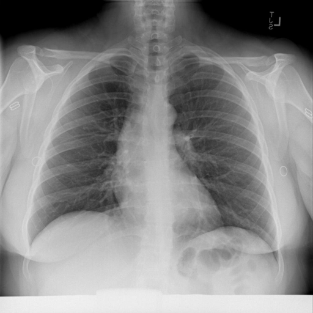

# chexbench_rad_restruct_0138
Ordinal 16; source Rad-Restruct; stopped-prefix record.

Are there any diseases in the abdomen?

## Complete options

- **A**: no
- **B**: yes

## Original images

Explicit answer: **A. no**; reference: **A**; correct: **True**.

Both expert models confirm no abnormalities are visible in the abdomen region of this chest X-ray.

[Prediction](../../evidence/chexbench/predictions/M43-IM-GT-S50-CXR6/chexbench_rad_restruct_0138.json) · [own post-prediction feedback](../../evidence/chexbench/feedback/chexbench_rad_restruct_0138.json) · [exact context and Skill version](../../evidence/chexbench/contexts/chexbench_rad_restruct_0138.json) · [all main requests/responses](../../evidence/chexbench/services/calls/R50-AGENT/chexbench_rad_restruct_0138)

## Tool requests and observations

- medgemma: status=completed; [selection](../../evidence/chexbench/services/tool_selections/R50-AGENT/chexbench_rad_restruct_0138/1.json), [full request/result/stdout/stderr artifacts](../../evidence/chexbench/services/tool_cache/f1cad94805558b1ca975b2eb90087b3e8e27b192a52f572b4935f01c0c53ee65).
- chest_xray_expert: status=completed; [selection](../../evidence/chexbench/services/tool_selections/R50-AGENT/chexbench_rad_restruct_0138/2.json), [full request/result/stdout/stderr artifacts](../../evidence/chexbench/services/tool_cache/4c70d914b43734c764b02429d8403187799a01427a9e1815d70ae47b7e3cba7a).

## Skill and prior-image provenance

Selected IDs: []; prior same-image IDs: [].

This is dataset-label scoring and model/tool narrative, not clinical adjudication or Skill causal verification.
