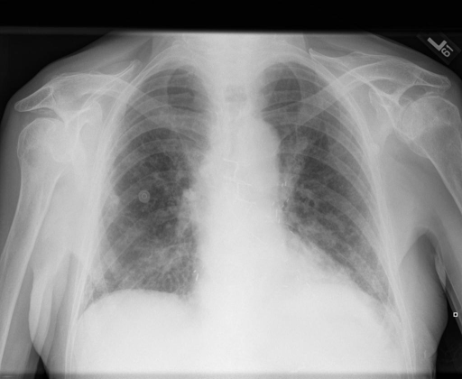
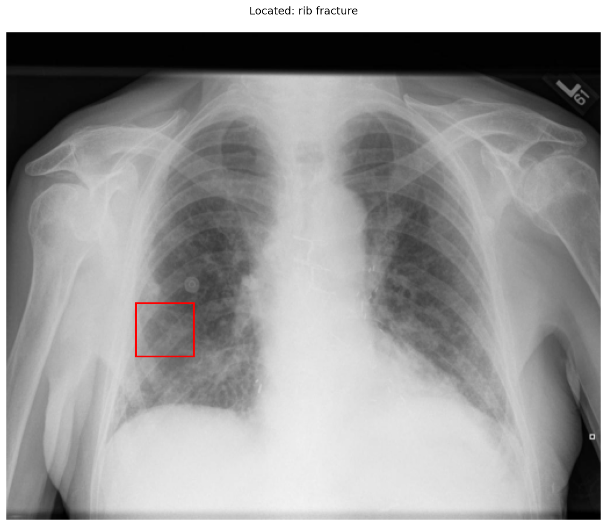

# chexbench_rad_restruct_0140
Ordinal 18; source Rad-Restruct; stopped-prefix record.

Are there any diseases in the skeletal system?

## Complete options

- **A**: no
- **B**: yes

## Original images

Explicit answer: **B. yes**; reference: **B**; correct: **True**.

Grounding evidence locates a rib fracture in the right hemithorax, confirming skeletal system disease.

[Prediction](../../evidence/chexbench/predictions/M43-IM-GT-S50-CXR6/chexbench_rad_restruct_0140.json) · [own post-prediction feedback](../../evidence/chexbench/feedback/chexbench_rad_restruct_0140.json) · [exact context and Skill version](../../evidence/chexbench/contexts/chexbench_rad_restruct_0140.json) · [all main requests/responses](../../evidence/chexbench/services/calls/R50-AGENT/chexbench_rad_restruct_0140)

## Tool requests and observations

- medgemma: status=completed; [selection](../../evidence/chexbench/services/tool_selections/R50-AGENT/chexbench_rad_restruct_0140/1.json), [full request/result/stdout/stderr artifacts](../../evidence/chexbench/services/tool_cache/eb00c8161aa57bd743619e4073026ce8511b71e12d1dd0fe1db60c8810b55ad5).
- chest_xray_expert: status=completed; [selection](../../evidence/chexbench/services/tool_selections/R50-AGENT/chexbench_rad_restruct_0140/2.json), [full request/result/stdout/stderr artifacts](../../evidence/chexbench/services/tool_cache/b0f0abbeb236d0b9a3fa6638b05014258ecc20f8bb381f95ea9f37fb44fb7499).
- llava_rad: status=completed; [selection](../../evidence/chexbench/services/tool_selections/R50-AGENT/chexbench_rad_restruct_0140/3.json), [full request/result/stdout/stderr artifacts](../../evidence/chexbench/services/tool_cache/3c2b085b70615b20d760fe3c1c55b8f2874f20fe29e564afbbd9852ee76a647d).
- xray_phrase_grounding: status=completed; [selection](../../evidence/chexbench/services/tool_selections/R50-AGENT/chexbench_rad_restruct_0140/4.json), [full request/result/stdout/stderr artifacts](../../evidence/chexbench/services/tool_cache/f03850e9482a24413e2e51334c6f9875d9d7fc26b81ea172e287fd440581dcb5).

## Skill and prior-image provenance

Selected IDs: []; prior same-image IDs: [].

This is dataset-label scoring and model/tool narrative, not clinical adjudication or Skill causal verification.
