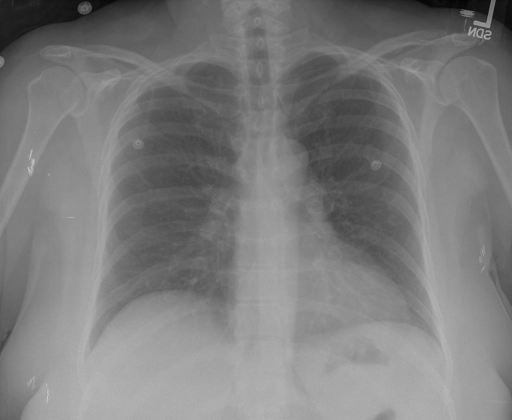

# chexbench_rad_restruct_0141
Ordinal 19; source Rad-Restruct; stopped-prefix record.

Is there anything abnormal in the lung?

## Complete options

- **A**: no
- **B**: yes

## Original images

Explicit answer: **A. no**; reference: **A**; correct: **True**.

Three independent VLMs (medgemma, llava_rad, llava_med_qa) confirm clear lung fields with no consolidation, effusion, or pneumothorax, outweighing the single conflicting chest_xray_expert output.

[Prediction](../../evidence/chexbench/predictions/M43-IM-GT-S50-CXR6/chexbench_rad_restruct_0141.json) · [own post-prediction feedback](../../evidence/chexbench/feedback/chexbench_rad_restruct_0141.json) · [exact context and Skill version](../../evidence/chexbench/contexts/chexbench_rad_restruct_0141.json) · [all main requests/responses](../../evidence/chexbench/services/calls/R50-AGENT/chexbench_rad_restruct_0141)

## Tool requests and observations

- medgemma: status=completed; [selection](../../evidence/chexbench/services/tool_selections/R50-AGENT/chexbench_rad_restruct_0141/1.json), [full request/result/stdout/stderr artifacts](../../evidence/chexbench/services/tool_cache/04971a12e5b6246b5fe3603a42559cd18076f49f4b35d3bc6ece16ec1a93e6ef).
- chest_xray_expert: status=completed; [selection](../../evidence/chexbench/services/tool_selections/R50-AGENT/chexbench_rad_restruct_0141/2.json), [full request/result/stdout/stderr artifacts](../../evidence/chexbench/services/tool_cache/5ac7ac4005ee03385af882ac646f1f732835c56dd672acd6434e162052ebf277).
- llava_rad: status=completed; [selection](../../evidence/chexbench/services/tool_selections/R50-AGENT/chexbench_rad_restruct_0141/3.json), [full request/result/stdout/stderr artifacts](../../evidence/chexbench/services/tool_cache/18768319f7a13fbcaa1546564098b553700a826a8dbe29092fdf391abad71562).
- medvlm_r1: status=completed; [selection](../../evidence/chexbench/services/tool_selections/R50-AGENT/chexbench_rad_restruct_0141/4.json), [full request/result/stdout/stderr artifacts](../../evidence/chexbench/services/tool_cache/5261d3a4349cdef4b72cfcda3b4af9e3c7cc0eec64765b44ca5fcfa16532dc99).
- llava_med_qa: status=completed; [selection](../../evidence/chexbench/services/tool_selections/R50-AGENT/chexbench_rad_restruct_0141/5.json), [full request/result/stdout/stderr artifacts](../../evidence/chexbench/services/tool_cache/782d46659b479c8f5d31707cb6ab2e0d085c9396006548575e50f18cfc2eab81).

## Skill and prior-image provenance

Selected IDs: []; prior same-image IDs: [].

This is dataset-label scoring and model/tool narrative, not clinical adjudication or Skill causal verification.
