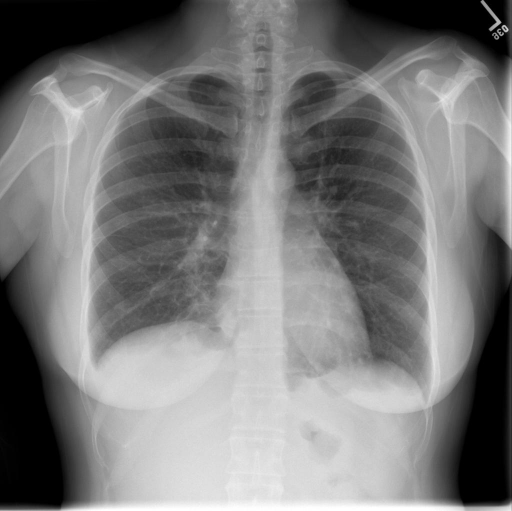

# chexbench_rad_restruct_0142
Ordinal 20; source Rad-Restruct; stopped-prefix record.

Are there any signs in the skeletal system?

## Complete options

- **A**: no
- **B**: yes

## Original images

Explicit answer: **A. no**; reference: **A**; correct: **True**.

Both medgemma and chest_xray_expert models confirm there are no visible fractures, lytic lesions, or other skeletal abnormalities in the ribs, clavicles, spine, or shoulders.

[Prediction](../../evidence/chexbench/predictions/M43-IM-GT-S50-CXR6/chexbench_rad_restruct_0142.json) · [own post-prediction feedback](../../evidence/chexbench/feedback/chexbench_rad_restruct_0142.json) · [exact context and Skill version](../../evidence/chexbench/contexts/chexbench_rad_restruct_0142.json) · [all main requests/responses](../../evidence/chexbench/services/calls/R50-AGENT/chexbench_rad_restruct_0142)

## Tool requests and observations

- medgemma: status=completed; [selection](../../evidence/chexbench/services/tool_selections/R50-AGENT/chexbench_rad_restruct_0142/1.json), [full request/result/stdout/stderr artifacts](../../evidence/chexbench/services/tool_cache/4cf970438ebf655f22876f0c01219710ad6d4a45dd1dc4894ab35bf2ac6226d9).
- chest_xray_expert: status=completed; [selection](../../evidence/chexbench/services/tool_selections/R50-AGENT/chexbench_rad_restruct_0142/2.json), [full request/result/stdout/stderr artifacts](../../evidence/chexbench/services/tool_cache/b44710317b569df31133c06c7e32af9ae9f93260caf00d80d937aa149a8c1214).

## Skill and prior-image provenance

Selected IDs: []; prior same-image IDs: [].

This is dataset-label scoring and model/tool narrative, not clinical adjudication or Skill causal verification.
