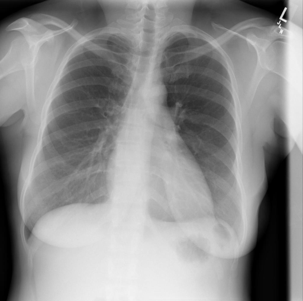

# chexbench_rad_restruct_0143
Ordinal 21; source Rad-Restruct; stopped-prefix record.

Are there any signs in the pleura?

## Complete options

- **A**: no
- **B**: yes

## Original images

Explicit answer: **A. no**; reference: **A**; correct: **True**.

Both MedGemma and CheXagent confirm sharp costophrenic angles and no visible pleural effusion, pneumothorax, or thickening.

[Prediction](../../evidence/chexbench/predictions/M43-IM-GT-S50-CXR6/chexbench_rad_restruct_0143.json) · [own post-prediction feedback](../../evidence/chexbench/feedback/chexbench_rad_restruct_0143.json) · [exact context and Skill version](../../evidence/chexbench/contexts/chexbench_rad_restruct_0143.json) · [all main requests/responses](../../evidence/chexbench/services/calls/R50-AGENT/chexbench_rad_restruct_0143)

## Tool requests and observations

- medgemma: status=completed; [selection](../../evidence/chexbench/services/tool_selections/R50-AGENT/chexbench_rad_restruct_0143/1.json), [full request/result/stdout/stderr artifacts](../../evidence/chexbench/services/tool_cache/25ca8db39ee4319437a6b1b372f18aa7383893d4e402be1a094b1cd2878060a1).
- chest_xray_expert: status=completed; [selection](../../evidence/chexbench/services/tool_selections/R50-AGENT/chexbench_rad_restruct_0143/2.json), [full request/result/stdout/stderr artifacts](../../evidence/chexbench/services/tool_cache/9232083c1f342914ca6b3d3bbc052644762c48fad65b8d620e5cbde7ff535baa).

## Skill and prior-image provenance

Selected IDs: []; prior same-image IDs: [].

This is dataset-label scoring and model/tool narrative, not clinical adjudication or Skill causal verification.
