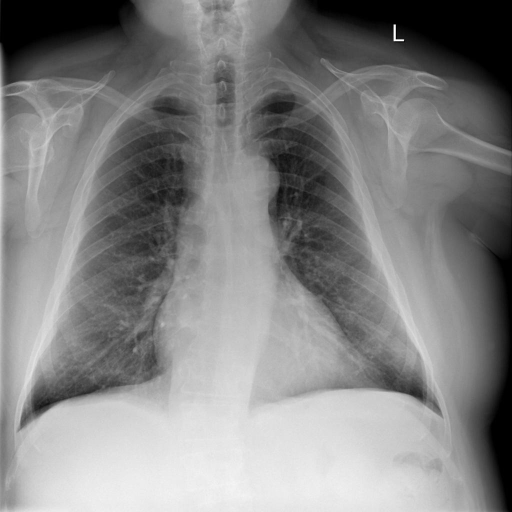

# chexbench_rad_restruct_0144
Ordinal 22; source Rad-Restruct; stopped-prefix record.

Is there anything abnormal in the abdomen?

## Complete options

- **A**: yes
- **B**: no

## Original images

Explicit answer: **B. no**; reference: **B**; correct: **True**.

The visible upper abdomen shows normal gastric bubble and no free air, calcifications, or organomegaly.

[Prediction](../../evidence/chexbench/predictions/M43-IM-GT-S50-CXR6/chexbench_rad_restruct_0144.json) · [own post-prediction feedback](../../evidence/chexbench/feedback/chexbench_rad_restruct_0144.json) · [exact context and Skill version](../../evidence/chexbench/contexts/chexbench_rad_restruct_0144.json) · [all main requests/responses](../../evidence/chexbench/services/calls/R50-AGENT/chexbench_rad_restruct_0144)

## Tool requests and observations

- medgemma: status=completed; [selection](../../evidence/chexbench/services/tool_selections/R50-AGENT/chexbench_rad_restruct_0144/1.json), [full request/result/stdout/stderr artifacts](../../evidence/chexbench/services/tool_cache/27db1087cd8c844b50e9f191fea732ae893703687b75fe01b92e3c3232851dce).
- chest_xray_expert: status=completed; [selection](../../evidence/chexbench/services/tool_selections/R50-AGENT/chexbench_rad_restruct_0144/2.json), [full request/result/stdout/stderr artifacts](../../evidence/chexbench/services/tool_cache/e6fd5a2c5c29b8b983b2f60b212a6ece8eee200911e6506657be2f6771981aa0).

## Skill and prior-image provenance

Selected IDs: []; prior same-image IDs: [].

This is dataset-label scoring and model/tool narrative, not clinical adjudication or Skill causal verification.
