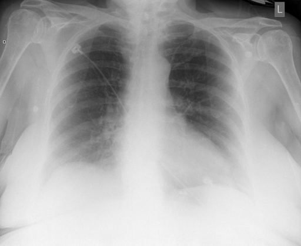

# chexbench_rad_restruct_0145
Ordinal 23; source Rad-Restruct; stopped-prefix record.

Are there any signs in the lung?

## Complete options

- **A**: yes
- **B**: no

## Original images

Explicit answer: **B. no**; reference: **A**; correct: **False**.

Both medgemma and chest_xray_expert confirm the lung fields are clear with no signs of pathology.

[Prediction](../../evidence/chexbench/predictions/M43-IM-GT-S50-CXR6/chexbench_rad_restruct_0145.json) · [own post-prediction feedback](../../evidence/chexbench/feedback/chexbench_rad_restruct_0145.json) · [exact context and Skill version](../../evidence/chexbench/contexts/chexbench_rad_restruct_0145.json) · [all main requests/responses](../../evidence/chexbench/services/calls/R50-AGENT/chexbench_rad_restruct_0145)

## Tool requests and observations

- medgemma: status=completed; [selection](../../evidence/chexbench/services/tool_selections/R50-AGENT/chexbench_rad_restruct_0145/1.json), [full request/result/stdout/stderr artifacts](../../evidence/chexbench/services/tool_cache/9ecc2aa8d5d6f1ec418f7a6ed53899427f0dc21094f2c54bfd0d12de92163f5b).
- chest_xray_expert: status=completed; [selection](../../evidence/chexbench/services/tool_selections/R50-AGENT/chexbench_rad_restruct_0145/2.json), [full request/result/stdout/stderr artifacts](../../evidence/chexbench/services/tool_cache/5aa4fdc6dfed9fe502cf05490855b6c94ca4cf73d7bfa2fe5ed73b817b6a9f7f).

## Skill and prior-image provenance

Selected IDs: []; prior same-image IDs: [].

This is dataset-label scoring and model/tool narrative, not clinical adjudication or Skill causal verification.
