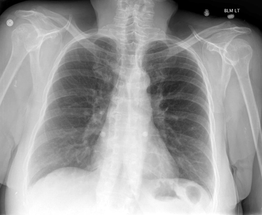

# chexbench_rad_restruct_0146
Ordinal 24; source Rad-Restruct; stopped-prefix record.

Is there anything abnormal in the lung?

## Complete options

- **A**: yes
- **B**: no

## Original images

Explicit answer: **B. no**; reference: **B**; correct: **True**.

Both medgemma and chest_xray_expert independently report clear lung fields with no consolidation, effusion, pneumothorax, or other abnormalities.

[Prediction](../../evidence/chexbench/predictions/M43-IM-GT-S50-CXR6/chexbench_rad_restruct_0146.json) · [own post-prediction feedback](../../evidence/chexbench/feedback/chexbench_rad_restruct_0146.json) · [exact context and Skill version](../../evidence/chexbench/contexts/chexbench_rad_restruct_0146.json) · [all main requests/responses](../../evidence/chexbench/services/calls/R50-AGENT/chexbench_rad_restruct_0146)

## Tool requests and observations

- medgemma: status=completed; [selection](../../evidence/chexbench/services/tool_selections/R50-AGENT/chexbench_rad_restruct_0146/1.json), [full request/result/stdout/stderr artifacts](../../evidence/chexbench/services/tool_cache/253b81133407a2faeb1af4d5573b6f44440a33364531e1870cd231402b299743).
- chest_xray_expert: status=completed; [selection](../../evidence/chexbench/services/tool_selections/R50-AGENT/chexbench_rad_restruct_0146/2.json), [full request/result/stdout/stderr artifacts](../../evidence/chexbench/services/tool_cache/3f4f4482fb474f628d76158e85f4a60d3a5166a9ca472ca856de0cfe4a7cb502).

## Skill and prior-image provenance

Selected IDs: []; prior same-image IDs: [].

This is dataset-label scoring and model/tool narrative, not clinical adjudication or Skill causal verification.
