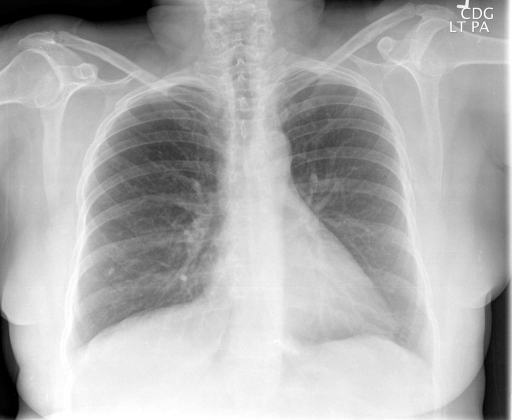

# chexbench_rad_restruct_0147
Ordinal 25; source Rad-Restruct; stopped-prefix record.

Is there anything abnormal in the pleura?

## Complete options

- **A**: yes
- **B**: no

## Original images

Explicit answer: **B. no**; reference: **B**; correct: **True**.

Both MedGemma and CheXagent confirm sharp costophrenic angles and no evidence of pleural effusion, pneumothorax, or thickening.

[Prediction](../../evidence/chexbench/predictions/M43-IM-GT-S50-CXR6/chexbench_rad_restruct_0147.json) · [own post-prediction feedback](../../evidence/chexbench/feedback/chexbench_rad_restruct_0147.json) · [exact context and Skill version](../../evidence/chexbench/contexts/chexbench_rad_restruct_0147.json) · [all main requests/responses](../../evidence/chexbench/services/calls/R50-AGENT/chexbench_rad_restruct_0147)

## Tool requests and observations

- medgemma: status=completed; [selection](../../evidence/chexbench/services/tool_selections/R50-AGENT/chexbench_rad_restruct_0147/1.json), [full request/result/stdout/stderr artifacts](../../evidence/chexbench/services/tool_cache/7218a0ee4c528729472832002d5bf21f8c03fc70e70cc88459ef8526cb3cbe67).
- chest_xray_expert: status=completed; [selection](../../evidence/chexbench/services/tool_selections/R50-AGENT/chexbench_rad_restruct_0147/2.json), [full request/result/stdout/stderr artifacts](../../evidence/chexbench/services/tool_cache/c12f325d63da84dad687a1e8a269d533544dd98d69f0352180b5950ea360f45d).

## Skill and prior-image provenance

Selected IDs: []; prior same-image IDs: [].

This is dataset-label scoring and model/tool narrative, not clinical adjudication or Skill causal verification.
