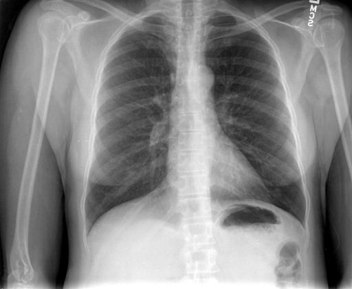

# chexbench_rad_restruct_0148
Ordinal 26; source Rad-Restruct; stopped-prefix record.

Are there any diseases in the pleura?

## Complete options

- **A**: yes
- **B**: no

## Original images

Explicit answer: **B. no**; reference: **B**; correct: **True**.

Both expert models agree there is no visible pleural disease such as effusion, pneumothorax, or thickening on the chest X-ray.

[Prediction](../../evidence/chexbench/predictions/M43-IM-GT-S50-CXR6/chexbench_rad_restruct_0148.json) · [own post-prediction feedback](../../evidence/chexbench/feedback/chexbench_rad_restruct_0148.json) · [exact context and Skill version](../../evidence/chexbench/contexts/chexbench_rad_restruct_0148.json) · [all main requests/responses](../../evidence/chexbench/services/calls/R50-AGENT/chexbench_rad_restruct_0148)

## Tool requests and observations

- medgemma: status=completed; [selection](../../evidence/chexbench/services/tool_selections/R50-AGENT/chexbench_rad_restruct_0148/1.json), [full request/result/stdout/stderr artifacts](../../evidence/chexbench/services/tool_cache/cb418c0a7c982efb31fa69444d9e6f045f7fd09bab81236d120e3b0233cfadc0).
- chest_xray_expert: status=completed; [selection](../../evidence/chexbench/services/tool_selections/R50-AGENT/chexbench_rad_restruct_0148/2.json), [full request/result/stdout/stderr artifacts](../../evidence/chexbench/services/tool_cache/4cf90aec22c6396b6cb8505e617157ebd8fdf6fd3decc579ca06d5a77cc60bfb).

## Skill and prior-image provenance

Selected IDs: []; prior same-image IDs: [].

This is dataset-label scoring and model/tool narrative, not clinical adjudication or Skill causal verification.
