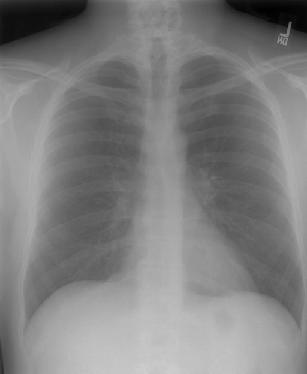

# chexbench_rad_restruct_0149
Ordinal 27; source Rad-Restruct; stopped-prefix record.

Is there anything abnormal in the trachea?

## Complete options

- **A**: yes
- **B**: no

## Original images

Explicit answer: **B. no**; reference: **B**; correct: **True**.

Both medgemma and chest_xray_expert independently confirm the trachea is midline with normal caliber and no deviation, narrowing, or mass effect.

[Prediction](../../evidence/chexbench/predictions/M43-IM-GT-S50-CXR6/chexbench_rad_restruct_0149.json) · [own post-prediction feedback](../../evidence/chexbench/feedback/chexbench_rad_restruct_0149.json) · [exact context and Skill version](../../evidence/chexbench/contexts/chexbench_rad_restruct_0149.json) · [all main requests/responses](../../evidence/chexbench/services/calls/R50-AGENT/chexbench_rad_restruct_0149)

## Tool requests and observations

- medgemma: status=completed; [selection](../../evidence/chexbench/services/tool_selections/R50-AGENT/chexbench_rad_restruct_0149/1.json), [full request/result/stdout/stderr artifacts](../../evidence/chexbench/services/tool_cache/8684613f35dbe521adfe0cff1d6fac597e12ba0d3968fb3ec296645a76803521).
- chest_xray_expert: status=completed; [selection](../../evidence/chexbench/services/tool_selections/R50-AGENT/chexbench_rad_restruct_0149/2.json), [full request/result/stdout/stderr artifacts](../../evidence/chexbench/services/tool_cache/88a4d5afb69523a3f161e50bece37efa8e14c505a38aed8a41e0eaf2e17a404e).

## Skill and prior-image provenance

Selected IDs: []; prior same-image IDs: [].

This is dataset-label scoring and model/tool narrative, not clinical adjudication or Skill causal verification.
