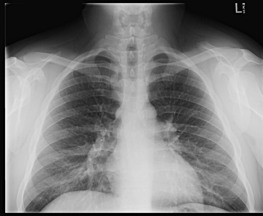

# chexbench_rad_restruct_0150
Ordinal 28; source Rad-Restruct; stopped-prefix record.

Are there any diseases in the breast?

## Complete options

- **A**: yes
- **B**: no

## Original images

Explicit answer: **B. no**; reference: **B**; correct: **True**.

Chest X-ray shows no visible breast masses, calcifications, or abnormalities.

[Prediction](../../evidence/chexbench/predictions/M43-IM-GT-S50-CXR6/chexbench_rad_restruct_0150.json) · [own post-prediction feedback](../../evidence/chexbench/feedback/chexbench_rad_restruct_0150.json) · [exact context and Skill version](../../evidence/chexbench/contexts/chexbench_rad_restruct_0150.json) · [all main requests/responses](../../evidence/chexbench/services/calls/R50-AGENT/chexbench_rad_restruct_0150)

## Tool requests and observations

- medgemma: status=completed; [selection](../../evidence/chexbench/services/tool_selections/R50-AGENT/chexbench_rad_restruct_0150/1.json), [full request/result/stdout/stderr artifacts](../../evidence/chexbench/services/tool_cache/b17f41b23e606dc96ca4204ac9fef12a557d376c669ce77c1105ca886ccbb818).
- chest_xray_expert: status=completed; [selection](../../evidence/chexbench/services/tool_selections/R50-AGENT/chexbench_rad_restruct_0150/2.json), [full request/result/stdout/stderr artifacts](../../evidence/chexbench/services/tool_cache/44d3895497f6d92d54c5e68fd85e700fd87d3bb0b3ab518381aa595ac3c38acd).

## Skill and prior-image provenance

Selected IDs: []; prior same-image IDs: [].

This is dataset-label scoring and model/tool narrative, not clinical adjudication or Skill causal verification.
