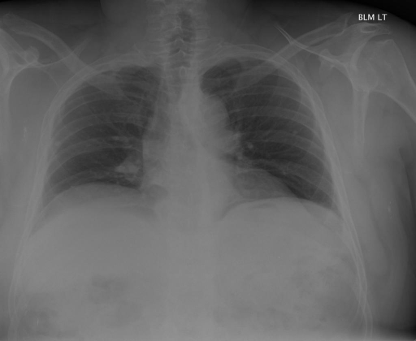

# chexbench_rad_restruct_0151
Ordinal 29; source Rad-Restruct; stopped-prefix record.

Is there anything abnormal in the abdomen?

## Complete options

- **A**: yes
- **B**: no

## Original images

Explicit answer: **B. no**; reference: **B**; correct: **True**.

Both expert models found no visible abdominal abnormalities such as free air, calcifications, or organomegaly on this chest X-ray.

[Prediction](../../evidence/chexbench/predictions/M43-IM-GT-S50-CXR6/chexbench_rad_restruct_0151.json) · [own post-prediction feedback](../../evidence/chexbench/feedback/chexbench_rad_restruct_0151.json) · [exact context and Skill version](../../evidence/chexbench/contexts/chexbench_rad_restruct_0151.json) · [all main requests/responses](../../evidence/chexbench/services/calls/R50-AGENT/chexbench_rad_restruct_0151)

## Tool requests and observations

- medgemma: status=completed; [selection](../../evidence/chexbench/services/tool_selections/R50-AGENT/chexbench_rad_restruct_0151/1.json), [full request/result/stdout/stderr artifacts](../../evidence/chexbench/services/tool_cache/77e0d700739d6136242a672a92b8f7d6e0e2f9ba581f983637f5ed4e10b3ed9e).
- chest_xray_expert: status=completed; [selection](../../evidence/chexbench/services/tool_selections/R50-AGENT/chexbench_rad_restruct_0151/2.json), [full request/result/stdout/stderr artifacts](../../evidence/chexbench/services/tool_cache/a62340ae0a25ad5ba331929594cf0e425d608b1b1be8f0f4a74086ac3c19f55e).

## Skill and prior-image provenance

Selected IDs: []; prior same-image IDs: [].

This is dataset-label scoring and model/tool narrative, not clinical adjudication or Skill causal verification.
