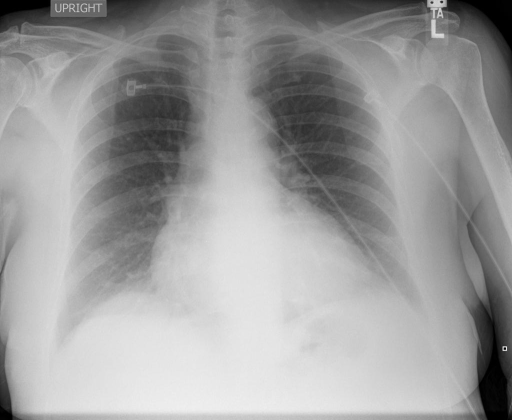

# chexbench_rad_restruct_0152
Ordinal 30; source Rad-Restruct; stopped-prefix record.

Is there anything abnormal in the abdomen?

## Complete options

- **A**: yes
- **B**: no

## Original images

Explicit answer: **B. no**; reference: **B**; correct: **True**.

Both models agree the visible upper abdomen shows no abnormality such as free air.

[Prediction](../../evidence/chexbench/predictions/M43-IM-GT-S50-CXR6/chexbench_rad_restruct_0152.json) · [own post-prediction feedback](../../evidence/chexbench/feedback/chexbench_rad_restruct_0152.json) · [exact context and Skill version](../../evidence/chexbench/contexts/chexbench_rad_restruct_0152.json) · [all main requests/responses](../../evidence/chexbench/services/calls/R50-AGENT/chexbench_rad_restruct_0152)

## Tool requests and observations

- medgemma: status=completed; [selection](../../evidence/chexbench/services/tool_selections/R50-AGENT/chexbench_rad_restruct_0152/1.json), [full request/result/stdout/stderr artifacts](../../evidence/chexbench/services/tool_cache/2565629c4080053941ac4adea6572324ed063546b352601062d94e8a5dd0eed1).
- chest_xray_expert: status=completed; [selection](../../evidence/chexbench/services/tool_selections/R50-AGENT/chexbench_rad_restruct_0152/2.json), [full request/result/stdout/stderr artifacts](../../evidence/chexbench/services/tool_cache/f5d3339bbe9f46900bb740c4409bd9133d546e49f738d9c39a4525b817456d4d).

## Skill and prior-image provenance

Selected IDs: []; prior same-image IDs: [].

This is dataset-label scoring and model/tool narrative, not clinical adjudication or Skill causal verification.
