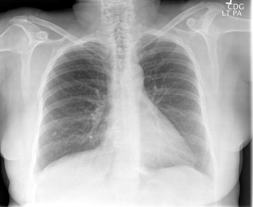

# chexbench_rad_restruct_0153
Ordinal 31; source Rad-Restruct; stopped-prefix record.

Is there anything abnormal in the abdomen?

## Complete options

- **A**: yes
- **B**: no

## Original images

Explicit answer: **B. no**; reference: **B**; correct: **True**.

Both MedGemma and CheXagent report no obvious abdominal abnormality, and visual inspection shows normal subdiaphragmatic gas patterns without free air or organomegaly.

[Prediction](../../evidence/chexbench/predictions/M43-IM-GT-S50-CXR6/chexbench_rad_restruct_0153.json) · [own post-prediction feedback](../../evidence/chexbench/feedback/chexbench_rad_restruct_0153.json) · [exact context and Skill version](../../evidence/chexbench/contexts/chexbench_rad_restruct_0153.json) · [all main requests/responses](../../evidence/chexbench/services/calls/R50-AGENT/chexbench_rad_restruct_0153)

## Tool requests and observations

- medgemma: status=completed; [selection](../../evidence/chexbench/services/tool_selections/R50-AGENT/chexbench_rad_restruct_0153/1.json), [full request/result/stdout/stderr artifacts](../../evidence/chexbench/services/tool_cache/51fcf536cf4f2fd08d840ee7ea2692f42614bfa117df4b6759aab98942a7c279).
- chest_xray_expert: status=completed; [selection](../../evidence/chexbench/services/tool_selections/R50-AGENT/chexbench_rad_restruct_0153/2.json), [full request/result/stdout/stderr artifacts](../../evidence/chexbench/services/tool_cache/81f8cb8e6a16ffa53d5f3783fa7bae0e67cf61bcf5a02af74087ba8d8c5583b8).

## Skill and prior-image provenance

Selected IDs: []; prior same-image IDs: ['chexbench_rad_restruct_0147'].

This is dataset-label scoring and model/tool narrative, not clinical adjudication or Skill causal verification.
