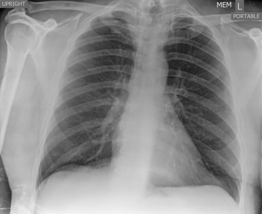

# chexbench_rad_restruct_0156
Ordinal 34; source Rad-Restruct; stopped-prefix record.

Are there any signs in the abdomen?

## Complete options

- **A**: no
- **B**: yes

## Original images

Explicit answer: **A. no**; reference: **A**; correct: **True**.

The chest X-ray shows no evidence of abdominal abnormalities such as free air or bowel dilation below the diaphragm.

[Prediction](../../evidence/chexbench/predictions/M43-IM-GT-S50-CXR6/chexbench_rad_restruct_0156.json) · [own post-prediction feedback](../../evidence/chexbench/feedback/chexbench_rad_restruct_0156.json) · [exact context and Skill version](../../evidence/chexbench/contexts/chexbench_rad_restruct_0156.json) · [all main requests/responses](../../evidence/chexbench/services/calls/R50-AGENT/chexbench_rad_restruct_0156)

## Tool requests and observations

- chest_xray_expert: status=completed; [selection](../../evidence/chexbench/services/tool_selections/R50-AGENT/chexbench_rad_restruct_0156/1.json), [full request/result/stdout/stderr artifacts](../../evidence/chexbench/services/tool_cache/c6b33f0dd691bd79e5f0ac792315e8708a79991390b39d4993daa32144e8c45b).

## Skill and prior-image provenance

Selected IDs: []; prior same-image IDs: ['chexbench_rad_restruct_0131'].

This is dataset-label scoring and model/tool narrative, not clinical adjudication or Skill causal verification.
