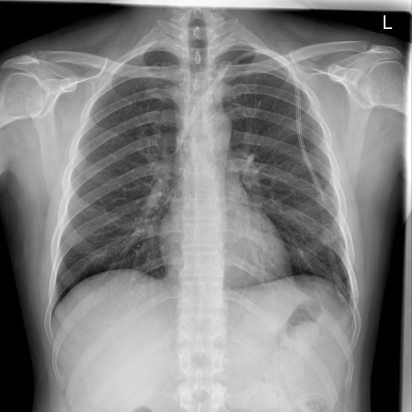

# chexbench_rad_restruct_0157
Ordinal 35; source Rad-Restruct; stopped-prefix record.

Are there any signs in the skeletal system?

## Complete options

- **A**: no
- **B**: yes

## Original images

Explicit answer: **A. no**; reference: **A**; correct: **True**.

Both MedGemma and CheXagent confirm the skeletal structures (ribs, clavicles, spine, shoulders) appear intact with no signs of fracture or deformity.

[Prediction](../../evidence/chexbench/predictions/M43-IM-GT-S50-CXR6/chexbench_rad_restruct_0157.json) · [own post-prediction feedback](../../evidence/chexbench/feedback/chexbench_rad_restruct_0157.json) · [exact context and Skill version](../../evidence/chexbench/contexts/chexbench_rad_restruct_0157.json) · [all main requests/responses](../../evidence/chexbench/services/calls/R50-AGENT/chexbench_rad_restruct_0157)

## Tool requests and observations

- medgemma: status=completed; [selection](../../evidence/chexbench/services/tool_selections/R50-AGENT/chexbench_rad_restruct_0157/1.json), [full request/result/stdout/stderr artifacts](../../evidence/chexbench/services/tool_cache/46fe36948ba60df29194949570d3c8243d5aabbdec8e912659f2cf24f316b866).
- chest_xray_expert: status=completed; [selection](../../evidence/chexbench/services/tool_selections/R50-AGENT/chexbench_rad_restruct_0157/2.json), [full request/result/stdout/stderr artifacts](../../evidence/chexbench/services/tool_cache/f587ad3ffa810b9419f15d1101952e0107bf82c6e24b06bdfcf0da0658b1f58c).

## Skill and prior-image provenance

Selected IDs: []; prior same-image IDs: [].

This is dataset-label scoring and model/tool narrative, not clinical adjudication or Skill causal verification.
