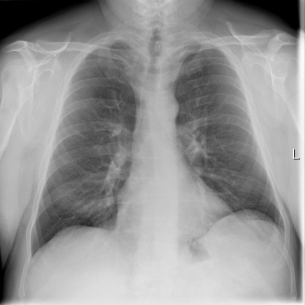

# chexbench_rad_restruct_0158
Ordinal 36; source Rad-Restruct; stopped-prefix record.

Is there anything abnormal in the skeletal system?

## Complete options

- **A**: no
- **B**: yes

## Original images

Explicit answer: **A. no**; reference: **A**; correct: **True**.

Both MedGemma and CheXagent confirm no visible fractures, lytic lesions, or skeletal abnormalities in the ribs, clavicles, scapulae, or spine.

[Prediction](../../evidence/chexbench/predictions/M43-IM-GT-S50-CXR6/chexbench_rad_restruct_0158.json) · [own post-prediction feedback](../../evidence/chexbench/feedback/chexbench_rad_restruct_0158.json) · [exact context and Skill version](../../evidence/chexbench/contexts/chexbench_rad_restruct_0158.json) · [all main requests/responses](../../evidence/chexbench/services/calls/R50-AGENT/chexbench_rad_restruct_0158)

## Tool requests and observations

- medgemma: status=completed; [selection](../../evidence/chexbench/services/tool_selections/R50-AGENT/chexbench_rad_restruct_0158/1.json), [full request/result/stdout/stderr artifacts](../../evidence/chexbench/services/tool_cache/5d18557d705da6317a1d9b2a40ec01f6b9eff6a9c9daae77d12cf9b7b18b65a6).
- chest_xray_expert: status=completed; [selection](../../evidence/chexbench/services/tool_selections/R50-AGENT/chexbench_rad_restruct_0158/2.json), [full request/result/stdout/stderr artifacts](../../evidence/chexbench/services/tool_cache/01697a03c8bd27b6f5f3c051b4787968c80bf5c9b657e049722fb7dc70349799).

## Skill and prior-image provenance

Selected IDs: []; prior same-image IDs: [].

This is dataset-label scoring and model/tool narrative, not clinical adjudication or Skill causal verification.
