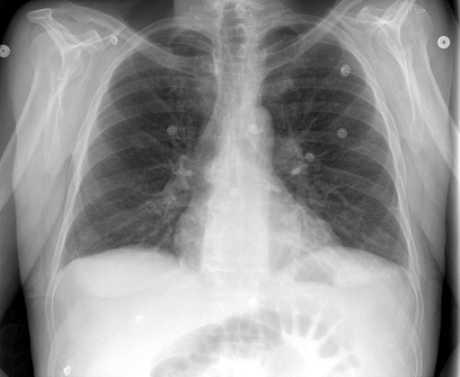

# chexbench_rad_restruct_0159
Ordinal 37; source Rad-Restruct; stopped-prefix record.

Are there any signs in the lung?

## Complete options

- **A**: no
- **B**: yes

## Original images

Explicit answer: **A. no**; reference: **A**; correct: **True**.

Both medgemma and chest_xray_expert confirm the lung fields are clear with no signs of consolidation, effusion, pneumothorax, or masses.

[Prediction](../../evidence/chexbench/predictions/M43-IM-GT-S50-CXR6/chexbench_rad_restruct_0159.json) · [own post-prediction feedback](../../evidence/chexbench/feedback/chexbench_rad_restruct_0159.json) · [exact context and Skill version](../../evidence/chexbench/contexts/chexbench_rad_restruct_0159.json) · [all main requests/responses](../../evidence/chexbench/services/calls/R50-AGENT/chexbench_rad_restruct_0159)

## Tool requests and observations

- medgemma: status=completed; [selection](../../evidence/chexbench/services/tool_selections/R50-AGENT/chexbench_rad_restruct_0159/1.json), [full request/result/stdout/stderr artifacts](../../evidence/chexbench/services/tool_cache/b51e5ef64555cb7ae80a22ded18707dba0f788bbc3964699aea11c4bb75d17f9).
- chest_xray_expert: status=completed; [selection](../../evidence/chexbench/services/tool_selections/R50-AGENT/chexbench_rad_restruct_0159/2.json), [full request/result/stdout/stderr artifacts](../../evidence/chexbench/services/tool_cache/dacbbe443bc8e85fb6347e54a5c433e6da45606f386793d73a66d86c0d1db0ee).

## Skill and prior-image provenance

Selected IDs: []; prior same-image IDs: [].

This is dataset-label scoring and model/tool narrative, not clinical adjudication or Skill causal verification.
