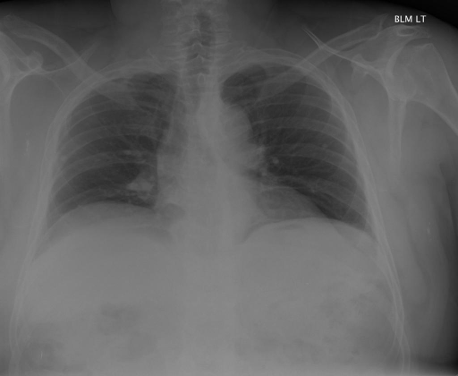

# chexbench_rad_restruct_0161
Ordinal 39; source Rad-Restruct; stopped-prefix record.

Are there any signs in the lung?

## Complete options

- **A**: yes
- **B**: no

## Original images

Explicit answer: **B. no**; reference: **A**; correct: **False**.

The chest X-ray shows clear lung fields with no visible signs of consolidation, effusion, pneumothorax, or masses.

[Prediction](../../evidence/chexbench/predictions/M43-IM-GT-S50-CXR6/chexbench_rad_restruct_0161.json) · [own post-prediction feedback](../../evidence/chexbench/feedback/chexbench_rad_restruct_0161.json) · [exact context and Skill version](../../evidence/chexbench/contexts/chexbench_rad_restruct_0161.json) · [all main requests/responses](../../evidence/chexbench/services/calls/R50-AGENT/chexbench_rad_restruct_0161)

## Tool requests and observations

- chest_xray_expert: status=completed; [selection](../../evidence/chexbench/services/tool_selections/R50-AGENT/chexbench_rad_restruct_0161/1.json), [full request/result/stdout/stderr artifacts](../../evidence/chexbench/services/tool_cache/ebdc9f436fe217582ccb3a9cdf522afadc463141ec9ce68216d1a17ed112ba72).

## Skill and prior-image provenance

Selected IDs: []; prior same-image IDs: ['chexbench_rad_restruct_0151'].

This is dataset-label scoring and model/tool narrative, not clinical adjudication or Skill causal verification.
