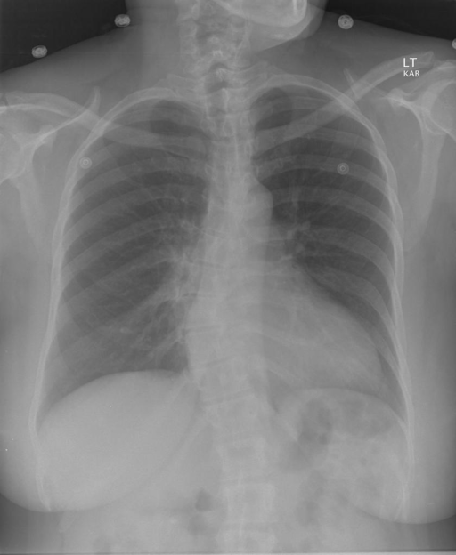

# chexbench_rad_restruct_0162
Ordinal 40; source Rad-Restruct; stopped-prefix record.

Are there any signs in the trachea?

## Complete options

- **A**: no
- **B**: yes

## Original images

Explicit answer: **A. no**; reference: **A**; correct: **True**.

Both expert models confirm the trachea is midline with normal caliber and no signs of abnormality.

[Prediction](../../evidence/chexbench/predictions/M43-IM-GT-S50-CXR6/chexbench_rad_restruct_0162.json) · [own post-prediction feedback](../../evidence/chexbench/feedback/chexbench_rad_restruct_0162.json) · [exact context and Skill version](../../evidence/chexbench/contexts/chexbench_rad_restruct_0162.json) · [all main requests/responses](../../evidence/chexbench/services/calls/R50-AGENT/chexbench_rad_restruct_0162)

## Tool requests and observations

- medgemma: status=completed; [selection](../../evidence/chexbench/services/tool_selections/R50-AGENT/chexbench_rad_restruct_0162/1.json), [full request/result/stdout/stderr artifacts](../../evidence/chexbench/services/tool_cache/52519388944818a6250fe06c44025c9d0986df07f85eb50c2a3865b1a42a10e7).
- chest_xray_expert: status=completed; [selection](../../evidence/chexbench/services/tool_selections/R50-AGENT/chexbench_rad_restruct_0162/2.json), [full request/result/stdout/stderr artifacts](../../evidence/chexbench/services/tool_cache/e94dcc57c4ccaf62612869f9b9fa61263ff2ee88f05401ed18f83f228cb65fbb).

## Skill and prior-image provenance

Selected IDs: []; prior same-image IDs: [].

This is dataset-label scoring and model/tool narrative, not clinical adjudication or Skill causal verification.
