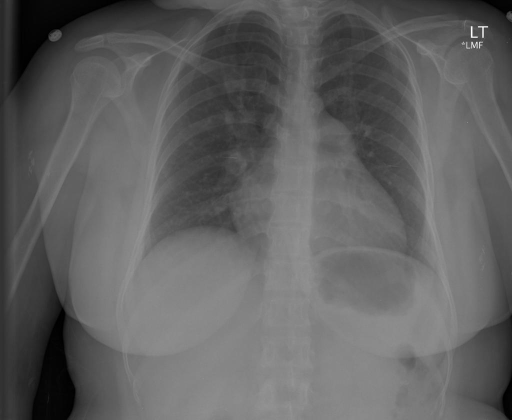

# chexbench_rad_restruct_0163
Ordinal 41; source Rad-Restruct; stopped-prefix record.

Are there any signs in the pleura?

## Complete options

- **A**: yes
- **B**: no

## Original images

Explicit answer: **B. no**; reference: **B**; correct: **True**.

Both expert models confirm clear costophrenic angles and no visible pleural effusion, pneumothorax, or thickening.

[Prediction](../../evidence/chexbench/predictions/M43-IM-GT-S50-CXR6/chexbench_rad_restruct_0163.json) · [own post-prediction feedback](../../evidence/chexbench/feedback/chexbench_rad_restruct_0163.json) · [exact context and Skill version](../../evidence/chexbench/contexts/chexbench_rad_restruct_0163.json) · [all main requests/responses](../../evidence/chexbench/services/calls/R50-AGENT/chexbench_rad_restruct_0163)

## Tool requests and observations

- medgemma: status=completed; [selection](../../evidence/chexbench/services/tool_selections/R50-AGENT/chexbench_rad_restruct_0163/1.json), [full request/result/stdout/stderr artifacts](../../evidence/chexbench/services/tool_cache/7ffffd686f3206120d77530b4543fc7e7d6f57a7bf1b28c2439457b5354aa63d).
- chest_xray_expert: status=completed; [selection](../../evidence/chexbench/services/tool_selections/R50-AGENT/chexbench_rad_restruct_0163/2.json), [full request/result/stdout/stderr artifacts](../../evidence/chexbench/services/tool_cache/f7b88cfb4f6da8eb1857e4be4d322ee3b6683ce2f8bfa651890a489d5ae5d5d2).

## Skill and prior-image provenance

Selected IDs: []; prior same-image IDs: [].

This is dataset-label scoring and model/tool narrative, not clinical adjudication or Skill causal verification.
