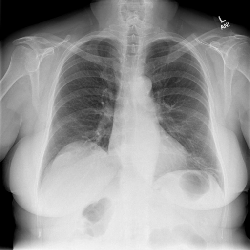

# chexbench_rad_restruct_0164
Ordinal 42; source Rad-Restruct; stopped-prefix record.

Are there any diseases in the thorax?

## Complete options

- **A**: no
- **B**: yes

## Original images

Explicit answer: **A. no**; reference: **A**; correct: **True**.

Both MedGemma and ChestXrayExpert models independently assessed the thorax as normal with no signs of disease.

[Prediction](../../evidence/chexbench/predictions/M43-IM-GT-S50-CXR6/chexbench_rad_restruct_0164.json) · [own post-prediction feedback](../../evidence/chexbench/feedback/chexbench_rad_restruct_0164.json) · [exact context and Skill version](../../evidence/chexbench/contexts/chexbench_rad_restruct_0164.json) · [all main requests/responses](../../evidence/chexbench/services/calls/R50-AGENT/chexbench_rad_restruct_0164)

## Tool requests and observations

- medgemma: status=completed; [selection](../../evidence/chexbench/services/tool_selections/R50-AGENT/chexbench_rad_restruct_0164/1.json), [full request/result/stdout/stderr artifacts](../../evidence/chexbench/services/tool_cache/485ea4ea9f9da31e078d2216c8497e60af4fab0eb47b71e6aab3353e0854851c).
- chest_xray_expert: status=completed; [selection](../../evidence/chexbench/services/tool_selections/R50-AGENT/chexbench_rad_restruct_0164/2.json), [full request/result/stdout/stderr artifacts](../../evidence/chexbench/services/tool_cache/fae24f10494bd1f9cb600676e20ceba8d942bfd15b54db664c91b6d651836a6c).

## Skill and prior-image provenance

Selected IDs: []; prior same-image IDs: [].

This is dataset-label scoring and model/tool narrative, not clinical adjudication or Skill causal verification.
