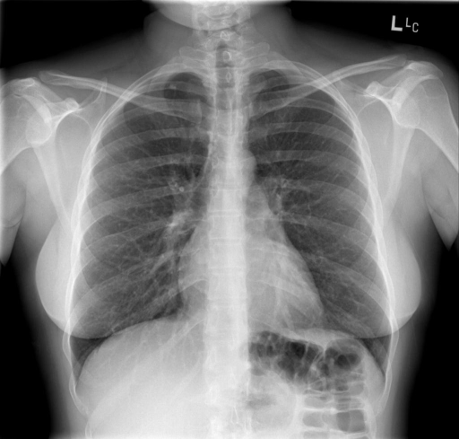

# chexbench_rad_restruct_0165
Ordinal 43; source Rad-Restruct; stopped-prefix record.

Is there anything abnormal in the lymph nodes?

## Complete options

- **A**: yes
- **B**: no

## Original images

Explicit answer: **B. no**; reference: **B**; correct: **True**.

Both chest_xray_expert and medgemma report no abnormal lymph nodes or mediastinal widening on the CXR.

[Prediction](../../evidence/chexbench/predictions/M43-IM-GT-S50-CXR6/chexbench_rad_restruct_0165.json) · [own post-prediction feedback](../../evidence/chexbench/feedback/chexbench_rad_restruct_0165.json) · [exact context and Skill version](../../evidence/chexbench/contexts/chexbench_rad_restruct_0165.json) · [all main requests/responses](../../evidence/chexbench/services/calls/R50-AGENT/chexbench_rad_restruct_0165)

## Tool requests and observations

- chest_xray_expert: status=completed; [selection](../../evidence/chexbench/services/tool_selections/R50-AGENT/chexbench_rad_restruct_0165/1.json), [full request/result/stdout/stderr artifacts](../../evidence/chexbench/services/tool_cache/54d052da2584e2c7555ebf5efd980c08e8c325b6648d0ed71f2c2ded994a05a2).
- medgemma: status=completed; [selection](../../evidence/chexbench/services/tool_selections/R50-AGENT/chexbench_rad_restruct_0165/2.json), [full request/result/stdout/stderr artifacts](../../evidence/chexbench/services/tool_cache/dc2d25ae33259ef4eea0796b2d5a15f8f5b0b9caf83ee2f42ecdc0f1082e1e38).

## Skill and prior-image provenance

Selected IDs: []; prior same-image IDs: [].

This is dataset-label scoring and model/tool narrative, not clinical adjudication or Skill causal verification.
