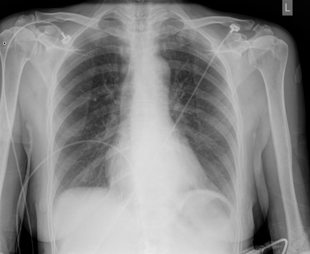

# chexbench_rad_restruct_0166
Ordinal 44; source Rad-Restruct; stopped-prefix record.

Are there any diseases in the breast?

## Complete options

- **A**: no
- **B**: yes

## Original images

Explicit answer: **A. no**; reference: **A**; correct: **True**.

Chest X-ray expert analysis confirms no visible abnormalities, masses, or calcifications in the breast tissue.

[Prediction](../../evidence/chexbench/predictions/M43-IM-GT-S50-CXR6/chexbench_rad_restruct_0166.json) · [own post-prediction feedback](../../evidence/chexbench/feedback/chexbench_rad_restruct_0166.json) · [exact context and Skill version](../../evidence/chexbench/contexts/chexbench_rad_restruct_0166.json) · [all main requests/responses](../../evidence/chexbench/services/calls/R50-AGENT/chexbench_rad_restruct_0166)

## Tool requests and observations

- medgemma: status=completed; [selection](../../evidence/chexbench/services/tool_selections/R50-AGENT/chexbench_rad_restruct_0166/1.json), [full request/result/stdout/stderr artifacts](../../evidence/chexbench/services/tool_cache/27b0813da52c41a338ae3b580b4a42d03ca809bd8ac841c0180d7e4db47edb2d).
- chest_xray_expert: status=completed; [selection](../../evidence/chexbench/services/tool_selections/R50-AGENT/chexbench_rad_restruct_0166/2.json), [full request/result/stdout/stderr artifacts](../../evidence/chexbench/services/tool_cache/c42a216bcc9a542095223a5078f5706968aa8d936654b4ecddc6408c53d64a6d).

## Skill and prior-image provenance

Selected IDs: []; prior same-image IDs: [].

This is dataset-label scoring and model/tool narrative, not clinical adjudication or Skill causal verification.
