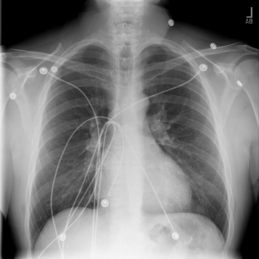

# chexbench_rad_restruct_0168
Ordinal 46; source Rad-Restruct; stopped-prefix record.

Is there anything abnormal in the skeletal system?

## Complete options

- **A**: no
- **B**: yes

## Original images

Explicit answer: **A. no**; reference: **A**; correct: **True**.

Both medgemma and chest_xray_expert models confirm no visible fractures, lesions, or skeletal abnormalities in the ribs, clavicles, or spine.

[Prediction](../../evidence/chexbench/predictions/M43-IM-GT-S50-CXR6/chexbench_rad_restruct_0168.json) · [own post-prediction feedback](../../evidence/chexbench/feedback/chexbench_rad_restruct_0168.json) · [exact context and Skill version](../../evidence/chexbench/contexts/chexbench_rad_restruct_0168.json) · [all main requests/responses](../../evidence/chexbench/services/calls/R50-AGENT/chexbench_rad_restruct_0168)

## Tool requests and observations

- medgemma: status=completed; [selection](../../evidence/chexbench/services/tool_selections/R50-AGENT/chexbench_rad_restruct_0168/1.json), [full request/result/stdout/stderr artifacts](../../evidence/chexbench/services/tool_cache/c55a76079fe7a0bc916037c8b07063552d6e895a1139c3753e385f4e2d6adca5).
- chest_xray_expert: status=completed; [selection](../../evidence/chexbench/services/tool_selections/R50-AGENT/chexbench_rad_restruct_0168/2.json), [full request/result/stdout/stderr artifacts](../../evidence/chexbench/services/tool_cache/7dc6bfcce08f5a09f541564f36372fd406c427a07808e8e68947512907d50290).

## Skill and prior-image provenance

Selected IDs: []; prior same-image IDs: [].

This is dataset-label scoring and model/tool narrative, not clinical adjudication or Skill causal verification.
