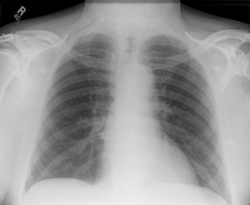

# chexbench_rad_restruct_0169
Ordinal 47; source Rad-Restruct; stopped-prefix record.

Are there any signs in the skeletal system?

## Complete options

- **A**: no
- **B**: yes

## Original images

Explicit answer: **A. no**; reference: **A**; correct: **True**.

Both MedGemma and CheXagent confirm no visible skeletal abnormalities such as fractures or lytic lesions in the ribs, clavicles, scapulae, or spine.

[Prediction](../../evidence/chexbench/predictions/M43-IM-GT-S50-CXR6/chexbench_rad_restruct_0169.json) · [own post-prediction feedback](../../evidence/chexbench/feedback/chexbench_rad_restruct_0169.json) · [exact context and Skill version](../../evidence/chexbench/contexts/chexbench_rad_restruct_0169.json) · [all main requests/responses](../../evidence/chexbench/services/calls/R50-AGENT/chexbench_rad_restruct_0169)

## Tool requests and observations

- medgemma: status=completed; [selection](../../evidence/chexbench/services/tool_selections/R50-AGENT/chexbench_rad_restruct_0169/1.json), [full request/result/stdout/stderr artifacts](../../evidence/chexbench/services/tool_cache/928c1d88a2be5939c084220d6caade9618f5c2fc2616e463e2be336e400779de).
- chest_xray_expert: status=completed; [selection](../../evidence/chexbench/services/tool_selections/R50-AGENT/chexbench_rad_restruct_0169/2.json), [full request/result/stdout/stderr artifacts](../../evidence/chexbench/services/tool_cache/d64bc35f9ed59366087fff65b7e58cbe9aefa9094cef27926b7e31cb5150e508).

## Skill and prior-image provenance

Selected IDs: []; prior same-image IDs: [].

This is dataset-label scoring and model/tool narrative, not clinical adjudication or Skill causal verification.
