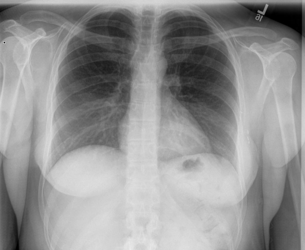

# chexbench_rad_restruct_0170
Ordinal 48; source Rad-Restruct; stopped-prefix record.

Are there any diseases in the lymph nodes?

## Complete options

- **A**: yes
- **B**: no

## Original images

Explicit answer: **B. no**; reference: **B**; correct: **True**.

The chest X-ray shows normal mediastinal and hilar contours without evidence of lymphadenopathy or enlarged lymph nodes.

[Prediction](../../evidence/chexbench/predictions/M43-IM-GT-S50-CXR6/chexbench_rad_restruct_0170.json) · [own post-prediction feedback](../../evidence/chexbench/feedback/chexbench_rad_restruct_0170.json) · [exact context and Skill version](../../evidence/chexbench/contexts/chexbench_rad_restruct_0170.json) · [all main requests/responses](../../evidence/chexbench/services/calls/R50-AGENT/chexbench_rad_restruct_0170)

## Tool requests and observations

- chest_xray_expert: status=completed; [selection](../../evidence/chexbench/services/tool_selections/R50-AGENT/chexbench_rad_restruct_0170/1.json), [full request/result/stdout/stderr artifacts](../../evidence/chexbench/services/tool_cache/331c4f820cb2a240d3992a500d45a579f6f16a50ef3e3f794fdacb9798312681).

## Skill and prior-image provenance

Selected IDs: []; prior same-image IDs: [].

This is dataset-label scoring and model/tool narrative, not clinical adjudication or Skill causal verification.
