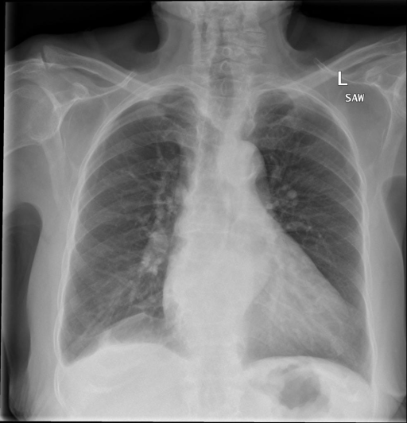

# chexbench_rad_restruct_0172
Ordinal 50; source Rad-Restruct; stopped-prefix record.

Is there anything abnormal in the cardiovascular system?

## Complete options

- **A**: no
- **B**: yes

## Original images

Explicit answer: **B. yes**; reference: **B**; correct: **True**.

Both medgemma and chest_xray_expert independently identify cardiovascular abnormalities, specifically cardiomegaly and a tortuous aorta.

[Prediction](../../evidence/chexbench/predictions/M43-IM-GT-S50-CXR6/chexbench_rad_restruct_0172.json) · [own post-prediction feedback](../../evidence/chexbench/feedback/chexbench_rad_restruct_0172.json) · [exact context and Skill version](../../evidence/chexbench/contexts/chexbench_rad_restruct_0172.json) · [all main requests/responses](../../evidence/chexbench/services/calls/R50-AGENT/chexbench_rad_restruct_0172)

## Tool requests and observations

- medgemma: status=completed; [selection](../../evidence/chexbench/services/tool_selections/R50-AGENT/chexbench_rad_restruct_0172/1.json), [full request/result/stdout/stderr artifacts](../../evidence/chexbench/services/tool_cache/ed3b24bb6b3f92a81ca5ecc8cf940dd65d5f41c4ffe4f23d87fbab39432dc0b8).
- chest_xray_expert: status=completed; [selection](../../evidence/chexbench/services/tool_selections/R50-AGENT/chexbench_rad_restruct_0172/2.json), [full request/result/stdout/stderr artifacts](../../evidence/chexbench/services/tool_cache/e48cfdb676025f65424da4391f892b0b44406c3ee503d7febf640e6b83b997e4).

## Skill and prior-image provenance

Selected IDs: []; prior same-image IDs: [].

This is dataset-label scoring and model/tool narrative, not clinical adjudication or Skill causal verification.
