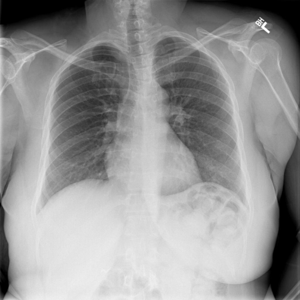

# chexbench_rad_restruct_0173
Ordinal 51; source Rad-Restruct; stopped-prefix record.

Is there anything abnormal in the skeletal system?

## Complete options

- **A**: yes
- **B**: no

## Original images

Explicit answer: **B. no**; reference: **B**; correct: **True**.

Visual inspection of the clavicles, ribs, scapulae, and spine reveals intact cortical margins with no evidence of fractures, lytic lesions, or deformities.

[Prediction](../../evidence/chexbench/predictions/M43-IM-GT-S50-CXR6/chexbench_rad_restruct_0173.json) · [own post-prediction feedback](../../evidence/chexbench/feedback/chexbench_rad_restruct_0173.json) · [exact context and Skill version](../../evidence/chexbench/contexts/chexbench_rad_restruct_0173.json) · [all main requests/responses](../../evidence/chexbench/services/calls/R50-AGENT/chexbench_rad_restruct_0173)

## Tool requests and observations

- chest_xray_expert: status=completed; [selection](../../evidence/chexbench/services/tool_selections/R50-AGENT/chexbench_rad_restruct_0173/1.json), [full request/result/stdout/stderr artifacts](../../evidence/chexbench/services/tool_cache/dcbce8a4ce147a5cfdcf14e10596f76117ae0aa644aa8342fb08456d26ef2719).

## Skill and prior-image provenance

Selected IDs: []; prior same-image IDs: [].

This is dataset-label scoring and model/tool narrative, not clinical adjudication or Skill causal verification.
