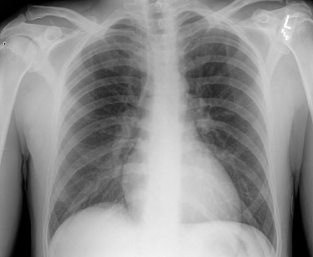

# chexbench_rad_restruct_0174
Ordinal 52; source Rad-Restruct; stopped-prefix record.

Is there anything abnormal in the abdomen?

## Complete options

- **A**: no
- **B**: yes

## Original images

Explicit answer: **A. no**; reference: **A**; correct: **True**.

Both models agree the visible upper abdomen on this chest X-ray shows no obvious abnormality.

[Prediction](../../evidence/chexbench/predictions/M43-IM-GT-S50-CXR6/chexbench_rad_restruct_0174.json) · [own post-prediction feedback](../../evidence/chexbench/feedback/chexbench_rad_restruct_0174.json) · [exact context and Skill version](../../evidence/chexbench/contexts/chexbench_rad_restruct_0174.json) · [all main requests/responses](../../evidence/chexbench/services/calls/R50-AGENT/chexbench_rad_restruct_0174)

## Tool requests and observations

- medgemma: status=completed; [selection](../../evidence/chexbench/services/tool_selections/R50-AGENT/chexbench_rad_restruct_0174/1.json), [full request/result/stdout/stderr artifacts](../../evidence/chexbench/services/tool_cache/7b38d9b180312947111a6198b35a93275dcef920af11e0b388ca9cf2756c7209).
- chest_xray_expert: status=completed; [selection](../../evidence/chexbench/services/tool_selections/R50-AGENT/chexbench_rad_restruct_0174/2.json), [full request/result/stdout/stderr artifacts](../../evidence/chexbench/services/tool_cache/c535a17a883003c0758ed7301dd8ac72fb949eb35d219e381325ccf11e2aa8e3).

## Skill and prior-image provenance

Selected IDs: []; prior same-image IDs: [].

This is dataset-label scoring and model/tool narrative, not clinical adjudication or Skill causal verification.
