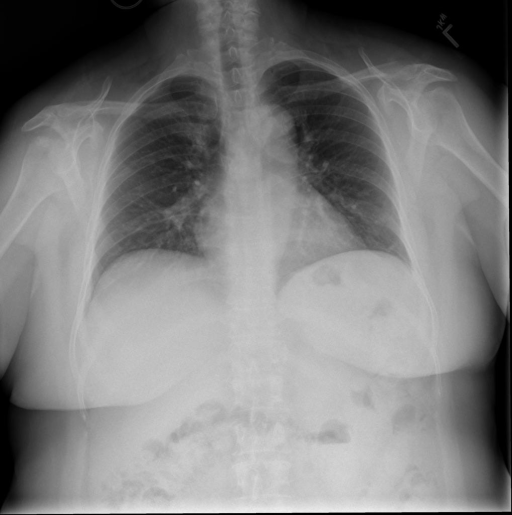

# chexbench_rad_restruct_0175
Ordinal 53; source Rad-Restruct; stopped-prefix record.

Are there any signs in the trachea?

## Complete options

- **A**: no
- **B**: yes

## Original images

Explicit answer: **A. no**; reference: **A**; correct: **True**.

The trachea is midline and shows no signs of deviation, narrowing, or mass.

[Prediction](../../evidence/chexbench/predictions/M43-IM-GT-S50-CXR6/chexbench_rad_restruct_0175.json) · [own post-prediction feedback](../../evidence/chexbench/feedback/chexbench_rad_restruct_0175.json) · [exact context and Skill version](../../evidence/chexbench/contexts/chexbench_rad_restruct_0175.json) · [all main requests/responses](../../evidence/chexbench/services/calls/R50-AGENT/chexbench_rad_restruct_0175)

## Tool requests and observations

- xray_phrase_grounding: status=completed; [selection](../../evidence/chexbench/services/tool_selections/R50-AGENT/chexbench_rad_restruct_0175/1.json), [full request/result/stdout/stderr artifacts](../../evidence/chexbench/services/tool_cache/75621eb807911c7cc9c6e967916cfea547db9f07e2739295618c7b8090d4816e).
- chest_xray_expert: status=completed; [selection](../../evidence/chexbench/services/tool_selections/R50-AGENT/chexbench_rad_restruct_0175/2.json), [full request/result/stdout/stderr artifacts](../../evidence/chexbench/services/tool_cache/0826228169f22d588bbf087cad84a14720abdc7aee0b95a8b7775da0f6c726fb).

## Skill and prior-image provenance

Selected IDs: []; prior same-image IDs: [].

This is dataset-label scoring and model/tool narrative, not clinical adjudication or Skill causal verification.
