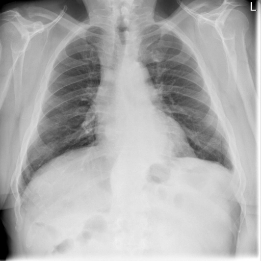

# chexbench_rad_restruct_0176
Ordinal 54; source Rad-Restruct; stopped-prefix record.

Are there any signs in the mediastinum?

## Complete options

- **A**: yes
- **B**: no

## Original images

Explicit answer: **B. no**; reference: **B**; correct: **True**.

Both expert models assessed the mediastinum as normal without signs of widening, mass, or abnormal contour.

[Prediction](../../evidence/chexbench/predictions/M43-IM-GT-S50-CXR6/chexbench_rad_restruct_0176.json) · [own post-prediction feedback](../../evidence/chexbench/feedback/chexbench_rad_restruct_0176.json) · [exact context and Skill version](../../evidence/chexbench/contexts/chexbench_rad_restruct_0176.json) · [all main requests/responses](../../evidence/chexbench/services/calls/R50-AGENT/chexbench_rad_restruct_0176)

## Tool requests and observations

- medgemma: status=completed; [selection](../../evidence/chexbench/services/tool_selections/R50-AGENT/chexbench_rad_restruct_0176/1.json), [full request/result/stdout/stderr artifacts](../../evidence/chexbench/services/tool_cache/cc73bfe7fc01ae4012a4bf5551e53835d2ea26f9690673e369c06930b8b1c886).
- chest_xray_expert: status=completed; [selection](../../evidence/chexbench/services/tool_selections/R50-AGENT/chexbench_rad_restruct_0176/2.json), [full request/result/stdout/stderr artifacts](../../evidence/chexbench/services/tool_cache/c278b1e9b6f1575e71e6c577f0af2d6afdd196ab2e0cb390b087b58a01ecab5a).

## Skill and prior-image provenance

Selected IDs: []; prior same-image IDs: [].

This is dataset-label scoring and model/tool narrative, not clinical adjudication or Skill causal verification.
