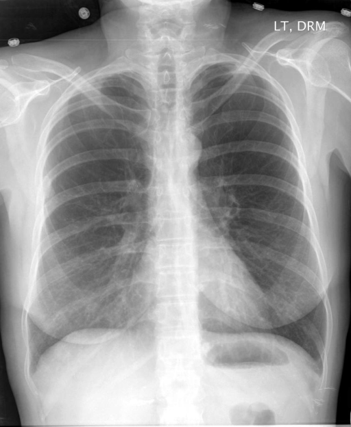

# chexbench_rad_restruct_0177
Ordinal 55; source Rad-Restruct; stopped-prefix record.

Are there any signs in the abdomen?

## Complete options

- **A**: no
- **B**: yes

## Original images

Explicit answer: **A**; reference: **A**; correct: **True**.

Both MedGemma and ChestXrayExpert confirm no abnormal signs are visible in the abdomen.

[Prediction](../../evidence/chexbench/predictions/M43-IM-GT-S50-CXR6/chexbench_rad_restruct_0177.json) · [own post-prediction feedback](../../evidence/chexbench/feedback/chexbench_rad_restruct_0177.json) · [exact context and Skill version](../../evidence/chexbench/contexts/chexbench_rad_restruct_0177.json) · [all main requests/responses](../../evidence/chexbench/services/calls/R50-AGENT/chexbench_rad_restruct_0177)

## Tool requests and observations

- medgemma: status=completed; [selection](../../evidence/chexbench/services/tool_selections/R50-AGENT/chexbench_rad_restruct_0177/1.json), [full request/result/stdout/stderr artifacts](../../evidence/chexbench/services/tool_cache/9c62e02f9a2fadfe5cac17869abbdd024c9cbbbea124a7f699ff9e49896ed957).
- chest_xray_expert: status=completed; [selection](../../evidence/chexbench/services/tool_selections/R50-AGENT/chexbench_rad_restruct_0177/2.json), [full request/result/stdout/stderr artifacts](../../evidence/chexbench/services/tool_cache/a0bb978565f8854e69f1ad23fc83a3dcc8af3ca908a961aa53551829468ddedc).

## Skill and prior-image provenance

Selected IDs: []; prior same-image IDs: [].

This is dataset-label scoring and model/tool narrative, not clinical adjudication or Skill causal verification.
