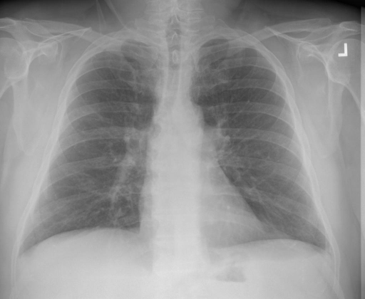

# chexbench_rad_restruct_0178
Ordinal 56; source Rad-Restruct; stopped-prefix record.

Are there any signs in the cardiovascular system?

## Complete options

- **A**: no
- **B**: yes

## Original images

Explicit answer: **B**; reference: **A**; correct: **False**.

Both expert models confirm the cardiac silhouette is normal with no cardiovascular abnormalities visible.

[Prediction](../../evidence/chexbench/predictions/M43-IM-GT-S50-CXR6/chexbench_rad_restruct_0178.json) · [own post-prediction feedback](../../evidence/chexbench/feedback/chexbench_rad_restruct_0178.json) · [exact context and Skill version](../../evidence/chexbench/contexts/chexbench_rad_restruct_0178.json) · [all main requests/responses](../../evidence/chexbench/services/calls/R50-AGENT/chexbench_rad_restruct_0178)

## Tool requests and observations

- medgemma: status=completed; [selection](../../evidence/chexbench/services/tool_selections/R50-AGENT/chexbench_rad_restruct_0178/1.json), [full request/result/stdout/stderr artifacts](../../evidence/chexbench/services/tool_cache/f18dfaa91bef2d9b356443783b1e156c9e4c0e17a99b36f32dd387f07c374e39).
- chest_xray_expert: status=completed; [selection](../../evidence/chexbench/services/tool_selections/R50-AGENT/chexbench_rad_restruct_0178/2.json), [full request/result/stdout/stderr artifacts](../../evidence/chexbench/services/tool_cache/37fa985073912e5f2fb1b4dd37db9120006c8272637193943175d5a590da0cf2).

## Skill and prior-image provenance

Selected IDs: []; prior same-image IDs: [].

This is dataset-label scoring and model/tool narrative, not clinical adjudication or Skill causal verification.
