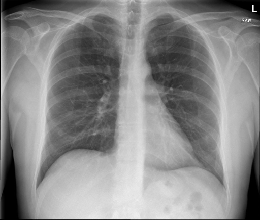

# chexbench_rad_restruct_0179
Ordinal 57; source Rad-Restruct; stopped-prefix record.

Are there any signs in the lung?

## Complete options

- **A**: yes
- **B**: no

## Original images

Explicit answer: **B. no**; reference: **B**; correct: **True**.

Both MedGemma and CheXagent confirm the lung fields are clear with no signs of pathology such as consolidation, effusion, or masses.

[Prediction](../../evidence/chexbench/predictions/M43-IM-GT-S50-CXR6/chexbench_rad_restruct_0179.json) · [own post-prediction feedback](../../evidence/chexbench/feedback/chexbench_rad_restruct_0179.json) · [exact context and Skill version](../../evidence/chexbench/contexts/chexbench_rad_restruct_0179.json) · [all main requests/responses](../../evidence/chexbench/services/calls/R50-AGENT/chexbench_rad_restruct_0179)

## Tool requests and observations

- medgemma: status=completed; [selection](../../evidence/chexbench/services/tool_selections/R50-AGENT/chexbench_rad_restruct_0179/1.json), [full request/result/stdout/stderr artifacts](../../evidence/chexbench/services/tool_cache/7adcde43f7048d7770195adfe697d49ddd7cc2a806f80500a7e1f5bc47c17ca5).
- chest_xray_expert: status=completed; [selection](../../evidence/chexbench/services/tool_selections/R50-AGENT/chexbench_rad_restruct_0179/2.json), [full request/result/stdout/stderr artifacts](../../evidence/chexbench/services/tool_cache/ca0e5520470bda828ec0b742bba165a45a18d0f5d4f4077149da2404bbf026cd).

## Skill and prior-image provenance

Selected IDs: []; prior same-image IDs: [].

This is dataset-label scoring and model/tool narrative, not clinical adjudication or Skill causal verification.
