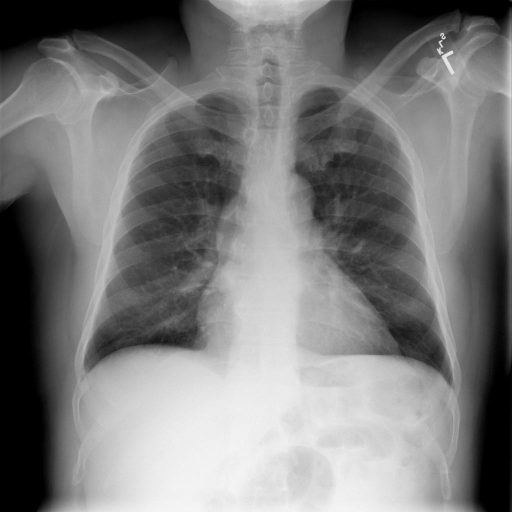

# chexbench_rad_restruct_0180
Ordinal 58; source Rad-Restruct; stopped-prefix record.

Are there any signs in the thorax?

## Complete options

- **A**: no
- **B**: yes

## Original images

Explicit answer: **A. no**; reference: **A**; correct: **True**.

Both medgemma and chest_xray_expert independently report no abnormal thoracic signs such as consolidation, effusion, pneumothorax, or masses.

[Prediction](../../evidence/chexbench/predictions/M43-IM-GT-S50-CXR6/chexbench_rad_restruct_0180.json) · [own post-prediction feedback](../../evidence/chexbench/feedback/chexbench_rad_restruct_0180.json) · [exact context and Skill version](../../evidence/chexbench/contexts/chexbench_rad_restruct_0180.json) · [all main requests/responses](../../evidence/chexbench/services/calls/R50-AGENT/chexbench_rad_restruct_0180)

## Tool requests and observations

- medgemma: status=completed; [selection](../../evidence/chexbench/services/tool_selections/R50-AGENT/chexbench_rad_restruct_0180/1.json), [full request/result/stdout/stderr artifacts](../../evidence/chexbench/services/tool_cache/f391fd15643abc6fec29729b063bdd3c3fdd19b2f1d111b98abe7bbfbbca61ac).
- chest_xray_expert: status=completed; [selection](../../evidence/chexbench/services/tool_selections/R50-AGENT/chexbench_rad_restruct_0180/2.json), [full request/result/stdout/stderr artifacts](../../evidence/chexbench/services/tool_cache/ef7127c6c55ce299b7bb09e3e57d2d67807eb47ec38bdc02b2d5be0c982ddbc5).

## Skill and prior-image provenance

Selected IDs: []; prior same-image IDs: [].

This is dataset-label scoring and model/tool narrative, not clinical adjudication or Skill causal verification.
