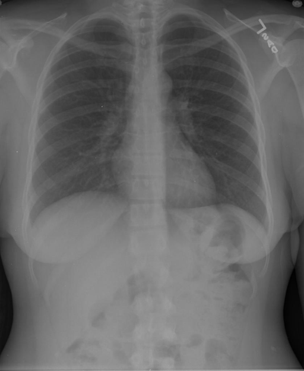

# chexbench_rad_restruct_0181
Ordinal 59; source Rad-Restruct; stopped-prefix record.

Is there anything abnormal in the cardiovascular system?

## Complete options

- **A**: yes
- **B**: no

## Original images

Explicit answer: **B. no**; reference: **B**; correct: **True**.

Both models agree the cardiac silhouette is normal in size and contour, indicating no cardiovascular abnormality.

[Prediction](../../evidence/chexbench/predictions/M43-IM-GT-S50-CXR6/chexbench_rad_restruct_0181.json) · [own post-prediction feedback](../../evidence/chexbench/feedback/chexbench_rad_restruct_0181.json) · [exact context and Skill version](../../evidence/chexbench/contexts/chexbench_rad_restruct_0181.json) · [all main requests/responses](../../evidence/chexbench/services/calls/R50-AGENT/chexbench_rad_restruct_0181)

## Tool requests and observations

- medgemma: status=completed; [selection](../../evidence/chexbench/services/tool_selections/R50-AGENT/chexbench_rad_restruct_0181/1.json), [full request/result/stdout/stderr artifacts](../../evidence/chexbench/services/tool_cache/2c0b23d791282d0db4fd4641374e5b4c446e1ceb98af80f7503aa092fcff43d4).
- chest_xray_expert: status=completed; [selection](../../evidence/chexbench/services/tool_selections/R50-AGENT/chexbench_rad_restruct_0181/2.json), [full request/result/stdout/stderr artifacts](../../evidence/chexbench/services/tool_cache/c1443459781c1adfa2e7437c7e52f6905cd1bc2346ac352de392814bb8f29874).

## Skill and prior-image provenance

Selected IDs: []; prior same-image IDs: [].

This is dataset-label scoring and model/tool narrative, not clinical adjudication or Skill causal verification.
