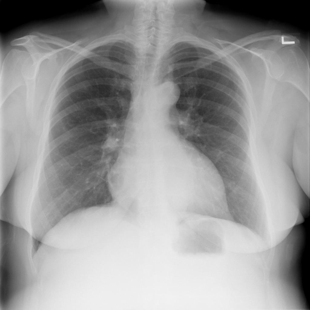

# chexbench_rad_restruct_0182
Ordinal 60; source Rad-Restruct; stopped-prefix record.

Are there any diseases in the skeletal system?

## Complete options

- **A**: yes
- **B**: no

## Original images

Explicit answer: **B. no**; reference: **B**; correct: **True**.

The skeletal structures including ribs, clavicles, spine, and shoulders appear intact and normal without visible fractures or disease.

[Prediction](../../evidence/chexbench/predictions/M43-IM-GT-S50-CXR6/chexbench_rad_restruct_0182.json) · [own post-prediction feedback](../../evidence/chexbench/feedback/chexbench_rad_restruct_0182.json) · [exact context and Skill version](../../evidence/chexbench/contexts/chexbench_rad_restruct_0182.json) · [all main requests/responses](../../evidence/chexbench/services/calls/R50-AGENT/chexbench_rad_restruct_0182)

## Tool requests and observations

- medgemma: status=completed; [selection](../../evidence/chexbench/services/tool_selections/R50-AGENT/chexbench_rad_restruct_0182/1.json), [full request/result/stdout/stderr artifacts](../../evidence/chexbench/services/tool_cache/2a26ad15c482ca34ccb56c6ec426ad9e6a51e77689f29e6baf76b6eb5a769490).

## Skill and prior-image provenance

Selected IDs: []; prior same-image IDs: [].

This is dataset-label scoring and model/tool narrative, not clinical adjudication or Skill causal verification.
